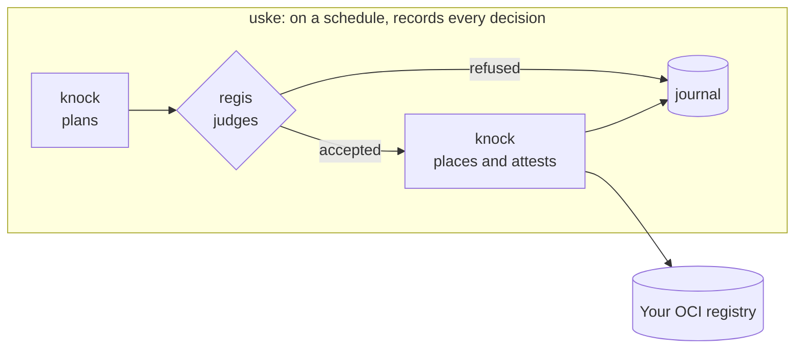
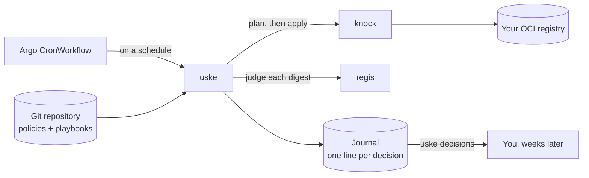

# uske

**Plays regis and knock together on a schedule, and keeps a record of every decision.**

<!-- trio:begin -->
> **regis** says whether. **knock** does. **uske** beats time, and records.

Together they form an admission gate for container images. [knock](https://github.com/trivoallan/knock)
plans every import, update or rebuild; [regis](https://github.com/trivoallan/regis) judges each image
against a declarative playbook; knock applies only what was accepted; [uske](https://github.com/trivoallan/uske)
runs this screening on a schedule and records every decision.


<!-- trio:end -->

## Why

Three weeks after an image was refused, someone asks why their deployment is stuck. Was it
refused, or never looked at? By which playbook? Was a repair attempted? If the answer lives in a
cron script's logs, it has already rotated away.

## What it does



- **Runs one screening per policy, on a schedule**, as an Argo Workflows `CronWorkflow`. A policy is
  a knock policy: which images to bring in, and how. A screening is one pass over it: plan, judge,
  place, record. Each policy gets its own child Workflow, so one can be replayed alone, and no
  volume is shared between them: their lines are merged into the journal at the end.
- **Asks regis only what is still owed a decision**, and hands knock only what was accepted.
- **Holds rebuilt images in a staging registry** until regis has judged them by their own digest:
  a rebuild is a new image, so it is judged again before it is placed.
- **Tries one repair** when a source is refused on rules knock can fix, then judges the result.
- **Appends one line per decision** to a journal that is never rewritten: weeks later, a refusal can
  still be found, explained and contested.

## Quick start

uske runs in Kubernetes. With Docker, `kind`, `kubectl` and `helm` installed, start a local
cluster with Argo Workflows and a registry, then follow the instructions it prints to start a
screening:

```bash
git clone https://github.com/trivoallan/uske && cd uske
deploy/kind/up.sh        # kind + Argo Workflows + a local registry
deploy/kind/up.sh down   # when you are done
```

To find out why an image was not placed, ask the journal: `uv run uske decisions <image> --results <dir>`
prints its timeline and the rule that refused it.

## Screen locally

Outside a cluster, on a workstation or in CI, one command runs the same steps with the same
decisions:

```bash
uv run uske screen --policies policies/ --playbooks playbooks/ --results results/ --transit transit
```

It is the only `uske` command that runs regis and knock itself: from `PATH`, or through the
prefixes in `USKE_REGIS_CMD` and `USKE_KNOCK_CMD` (a `docker run …`). `USKE_AFTER_RECORD` runs after
each journal write, before the next placement: commit the journal there. See
[Screen locally](docs/how-to/operate.md#screen-locally). To run it from a policy repository on GitHub,
see [Screen from GitHub Actions](docs/how-to/screen-from-github.md).

## Is it for you?

**For you if** you run regis and knock together, on Kubernetes with Argo Workflows, and need every
admission decision written down where it can be contested.

**Not for you if** you judge images in a single CI pipeline: call regis there directly.

## Documentation

Everything lives in [`docs/`](docs/):
[operate uske](docs/how-to/operate.md) ·
[screen from GitHub Actions](docs/how-to/screen-from-github.md) ·
[how it works](docs/explanation/how-it-works.md) ·
[journal states and reasons](docs/reference/reasons.md) ·
[architecture](docs/architecture/arc42.md) ·
[decisions](docs/adr/).

## Contributing

Issues and pull requests are welcome. Read [CONTRIBUTING.md](CONTRIBUTING.md) first.

## License

Apache License 2.0. See [LICENSE](LICENSE).
