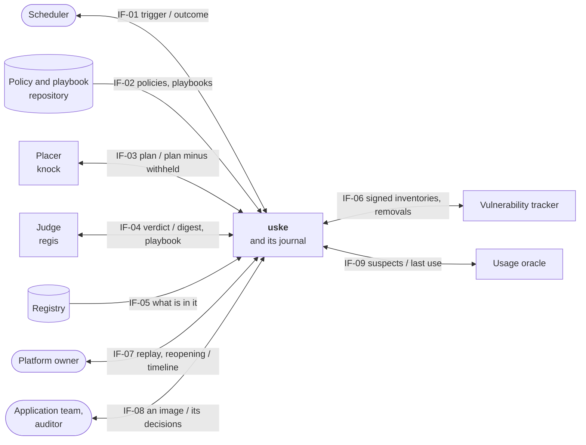
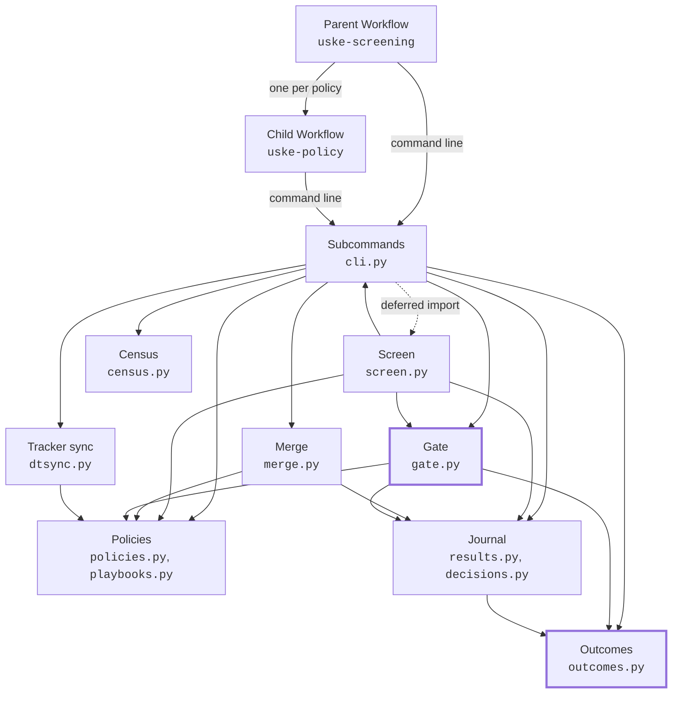
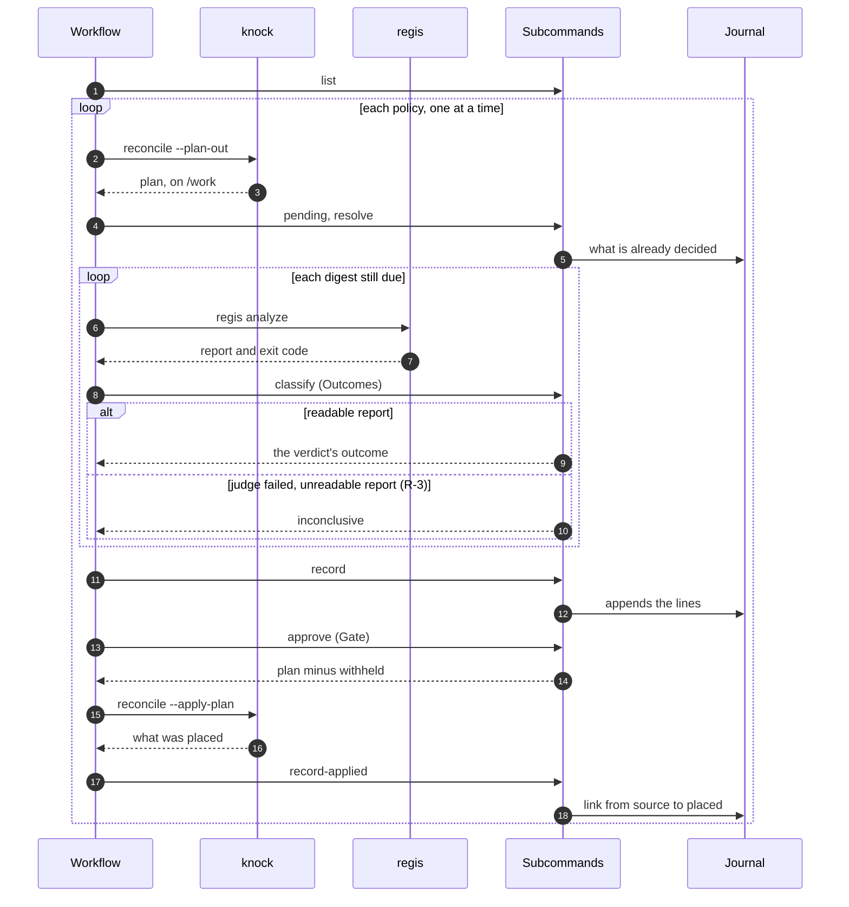
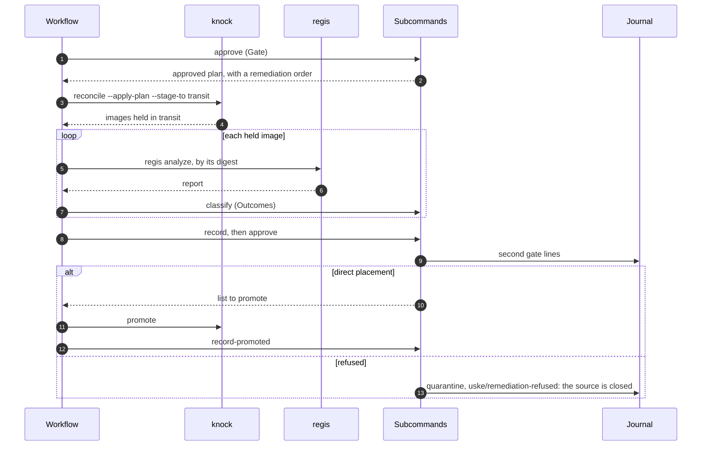
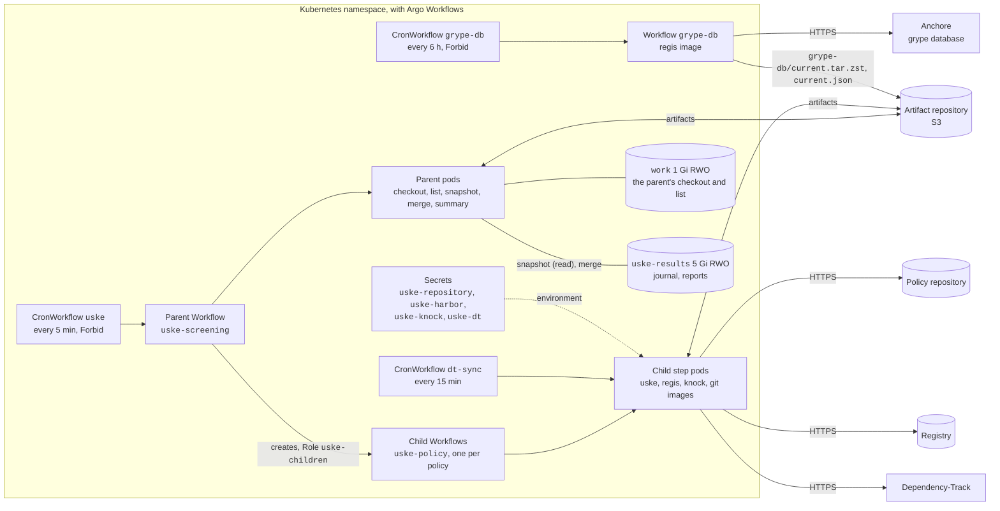
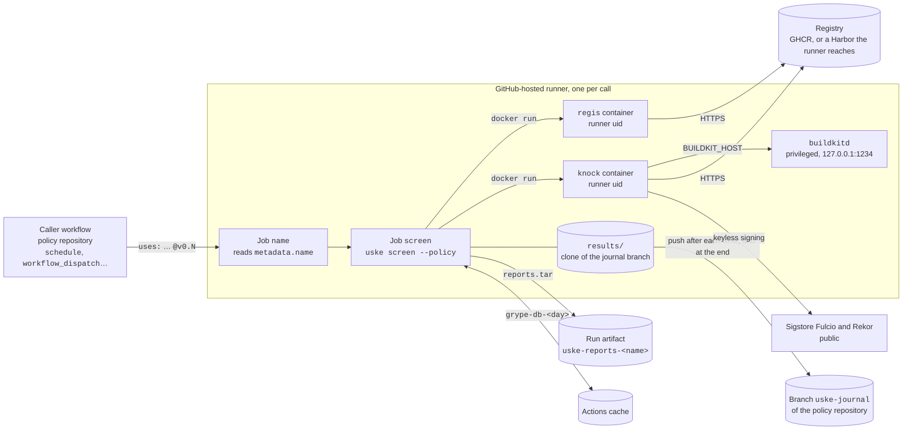

**About arc42**

arc42, the template for documentation of software and system
architecture.

Template Version 9.0-EN. (based upon AsciiDoc version), July 2025

Created, maintained and © by Dr. Peter Hruschka, Dr. Gernot Starke and
contributors. See <https://arc42.org>.

# Introduction and Goals

> State of this document on 2026-10-17: all twelve sections are written, at the **LEAN** level —
> tables rather than diagrams, and nothing the code does not do yet. A section is revised when a
> change moves what it describes.

## Requirements Overview

`uske` runs together a tool that **judges** a container image — the *judge*, `regis` — and a
tool that **places** it in a registry — the *placer*, `knock`. On a schedule, it runs a
*screening* on each active policy of a repository and records each decision. It judges nothing and
places nothing: its workflow has the judge and the placer run, each at its own step, and its
subcommands read what they leave, decide what goes on, and write it down.

### Essential Features

- List the active policies, kept in a separate repository that is checked out at each screening.
- Have the placer write its plan: each import, update or rebuild it is about to perform, with the
  digest of the source.
- Have each digest that still awaits a decision judged, with the playbook that the policy's track
  calls for.
- Classify each verdict into one of four outcomes: direct placement, transformation required,
  quarantine, inconclusive.
- Return the plan to the placer, minus the withheld operations — refused or inconclusive; the
  placer applies only that. A
  source judged *transformation required* only on rules that its track declares repairable stays
  in the plan, with a remediation order.
- Have the placer hold what it builds in a transit, have it judged by its own digest, and return
  to the placer for promotion only what comes out as direct placement.
- Append one line per outcome to a journal. Lines are appended, never rewritten.
- Run a census of the registry: what is in it, minus what was admitted, gives the bypass.
- Send the inventories signed by the placer to the vulnerability tracker, and remove from it what
  has left the registry.

### Business Context

Today, images enter a registry through in-house scripts and CI pipelines, written team by team:
judging and placing are mixed together, nothing is scheduled in a uniform way, and nothing can be
contested after the fact. **The first problem is the lack of automation; contestability comes
second.** `uske` serves the person who runs the registry — images enter on their own, according to
declared rules — and then the people who are subject to a decision or verify one: the team whose
image is refused, and the auditor who must prove what was admitted.

**Out of scope**: becoming generic glue for other judges or other placers; any graphical
interface.

### References

- [`openspec/discovery.md`](../../openspec/discovery.md) — personas, a journey annotated against
  the code, priorities, stories. This document takes its scope and goals from there, and copies
  nothing beyond them.
- [`README.md`](../../README.md) — what a screening does, step by step.

## Quality Goals

> Four goals, **ordered**: when they conflict, the higher rank wins. Each one states what it gives
> up — a goal that costs nothing is not a goal. Every architecture decision serves them, in this
> order. Source and order: `openspec/discovery.md`, answers received on 2026-09-20.

| Rank | Goal | Verifiable scenario | Gives up |
|:----:|------|---------------------|----------|
| 1 | **Safety** `#safe` — when in doubt, place nothing | A missing, unreadable or inconclusive verdict places nothing, as a refusal does — but it refuses nothing either: the outcome is `inconclusive`, and the next screening judges the image again. In a screening where the judge does not answer, **zero** operations are returned to the placer for the affected digests. | Freshness: a sound image can wait one more screening. |
| 2 | **Contestability** `#secure` (non-repudiation) — every decision is recorded, never rewritten, and can be found again | A refusal that is three weeks old is found and explained **in one minute** — date, state, playbook, reason; and the history of the journal shows **no** modified or deleted line. | A compact journal, and any in-place correction of a wrong line: you append, you do not cross out. |
| 3 | **Operability** `#operable` — a failed screening can be diagnosed and replayed without damage | **One** person replays an interrupted screening at any step; the replay places nothing twice and loses no result line. | Execution speed: the steps stay separate, readable and replayable rather than merged. |
| 4 | **Thinness** `#flexible` — `uske` neither judges nor places, and does not grow | `uske` contains **no** judging rule and **no** placing action: removing the judge or the placer leaves it with nothing to decide. | The convenience of a tool that would do everything. Last in rank: when safety requires `uske` to check something itself, it grows. |

The measurable scenarios are in *Quality Requirements* (`QS-01` to `QS-07`).

## Stakeholders

| Role/Name | Contact | Expectations |
|-----------|---------|--------------|
| **Platform owner** — runs the registry; main persona | persona; with no real person in the role, the maintainer answers | A screening runs on schedule without them, nothing doubtful gets in, and they understand the sequence of steps well enough to replay a failed screening on their own. |
| **Application team** — waits for an image to ship | persona; the maintainer answers | To know why its image did not arrive: the reason for the refusal and the rule applied, without digging. |
| **Security / compliance auditor** | persona; the maintainer answers | A journal that is authoritative: for an image and a date, the decision, the playbook and the reason; and proof that no line was rewritten. |
| **Author and maintainer** | repository `trivoallan/uske` | To know where to put code and what may depend on what; to find why a decision was made. First real user, on a single registry. |
| **Agents that write the changes** | the repository's agent context | To read the goals and the decisions in one place, without deducing them from the code. |

**These five roles are the stakeholders of the system, not the readership of this document.**
Three of them are personas: no real person holds them today, and the maintainer answers in their
place. The readership of the documentation is set to `public` by
[`SDR-0019`](../adr/SDR-0019-documentation-publique.md): the document is read outside the
organisation, and the domain terms — `screening`, `track`, `bypass`, `judge`, `placer` — are
defined in *Glossary*.

**Approval of the quality goals**: the maintainer, who set their order on 2026-09-20.

# Architecture Constraints

> What a developer cannot undo alone. The test applied to each line: *does getting out of it
> require an organisational decision?* If a change is enough to break free of it, it is not a
> constraint but a decision — and it belongs in *Architecture Decisions*.

| Constraint | Kind | What it imposes | How to get out of it |
|------------|------|-----------------|----------------------|
| **The `surdesrails` method** — installed as a development dependency of the repository | organisational | The format of decisions (MADR), their `SDR-nnnn` numbering, the schema that rejects an undecided decision, and the set of questions that every repository adopting it must answer. | Remove the dependency and answer each question by hand. That is not a change: it means giving up the method. |
| **An `accepted` ADR is frozen** — [`SDR-0001`](../adr/SDR-0001-record-architecture-decisions.md) | organisational | The body of a decided decision is not corrected. Everything that follows from one — French as the default, the programming language, the branching model, the coverage threshold — cannot be reopened by a change. | A new ADR that names the old one in its `supersedes:`. The old one stays in the directory. |
| **`regis` and `knock` are third-party repositories** | technical | `uske` knows them only by their command line and their exit code; it shares neither code nor data model with them. Their release cycles are not its own. | Nothing here: this is the separation that the **Thinness** goal serves, and giving it up would empty `uske` of its purpose. |

**The method is a constraint, not a decision, and that explains the shape of *Architecture
Decisions*.** The eleven ADRs inherited from the method were not chosen: they were laid down, with
their numbers and their questions. What this repository decides is the **answer** to each one —
not whether the question exists. A reader who took the decision log for a free deliberation would
misjudge what was actually decided here.

**The way out is named, and it is asymmetric.** A question that does not arise in this repository
gets the verdict `rejected` with its rationale, which silences it entirely; a single rule can be
waived by a local ADR that writes down its rationale. But some keys accept only one value, and
those cannot be waived — they are rejected as a whole.

# Context and Scope

> LEAN level: one diagram and one table per context. The boundary fits in one sentence — `uske`
> and its journal are inside, everything it works with is outside. The diagrams in this document are in
> Mermaid, which GitHub renders without a tool: that is what
> [`SDR-0019`](../adr/SDR-0019-documentation-publique.md) (`tool: aucun`) allows.
> The `IF-nn` identifiers are those of this document: an `IF-nn` cited in the code comes from the
> reference dossier, and does not designate the same interface.

## Business Context

`uske` is **in the middle and holds nothing**: each partner below judges, places, counts or
tracks, and `uske` only passes them what another one produced. The only thing it owns is the
**results journal** — that is why the journal is inside, and not a partner.

| ID | Partner | What comes into `uske` | What goes out of `uske` |
|----|---------|------------------------|-------------------------|
| IF-01 | **Scheduler** | The trigger of a screening | An outcome: success (refusals and inconclusive results included) or technical failure, to replay |
| IF-02 | **Policy and playbook repository** | The active policies and their track; the playbooks | nothing — read, never written |
| IF-03 | **Placer** (`knock`) | Its plan; what it held in transit; what it placed | The plan minus the withheld operations (refused or inconclusive); the list to promote |
| IF-04 | **Judge** (`regis`) | A verdict and its report, per digest | A digest and the playbook that the track calls for |
| IF-05 | **Registry** | What is in it | nothing — read, never written; `uske` neither places anything in it nor removes anything from it |
| IF-06 | **Vulnerability tracker** | What it already tracks | The inventories signed by the placer; the removal of what has left the registry |
| IF-07 | **Platform owner** | The replay of a screening; a reopening line appended to the journal | The timeline of an image's decisions |
| IF-08 | **Application team, auditor** | An image, or a state and a period | The decisions, the playbook and the reason for each one — read-only |
| IF-09 | **Usage oracle** — the command that the in-house retention already runs | The last time an image was used, or nothing | Only the images suspected of bypass, one by one |

**Outside the boundary, even if you think they are inside:**

- **The transit**, a repository path on the registry (see *Glossary*). `uske` names it to the
  placer, but neither reads nor writes it: the placer
  holds images there, the judge reads them there. Closing it to consumers is the registry's job.
- **Signing and attestation**: the placer signs; `uske` verifies a signature before sending an
  inventory (IF-06), and produces none.
- **The judging rules**: they live in the playbooks (IF-02) and in the judge. The only table that
  `uske` keeps is the one that maps a track to a playbook.

The rest of what is out of scope — generic glue, graphical interface — is set in the *Business
Context* of the first section.

## Technical Context

Each business interface has a single channel. **In the cluster, no `uske` subcommand starts
`regis` or `knock` as a process**: the workflow that `uske` ships (`deploy/base`) runs each one in
its own image, at its own step of the child Workflow, and the steps pass files to each other on
`/work`, which travels from step to step as an Argo artifact (*Cross-cutting Concepts*, *Files
between the steps*). When this document says that `uske` calls the judge or the placer, it means
this: its workflow runs the tool, and a following subcommand reads what it left. **Outside the
cluster, `uske screen` runs them itself**, by the same command lines, and reads the same files and
exit codes (`SDR-0021`). `uske` speaks HTTP only to the two APIs it knows by name.

| ID | Channel | Format | Authentication |
|----|---------|--------|----------------|
| IF-01 | Argo Workflows: a `CronWorkflow` chains the `uske` subcommands ([`deploy/base`](../../deploy/base)) | Command-line arguments, JSON on standard output; exit code 0 (business outcome) or 1 (technical failure, which Argo replays) | The `CronWorkflow` service account |
| IF-02 | `git`: the repository is checked out at each screening, in the `checkout` step | YAML (policies, playbooks) | The repository's own; named by the overlay's `repository` parameter |
| IF-03 | Separate Argo steps, `knock` image: `reconcile --plan-out`, `--apply-plan`, `--stage-to`, `promote`; files on `/work` | JSON (plan, audit) | `knock`'s registry credentials (`KNOCK_REGISTRIES`) |
| IF-04 | Separate Argo step, `regis` image: `regis analyze`; its exit code is passed to `uske classify` (`--regis-exit`) | JSON (report), on `/work` | `regis`'s registry credentials, on the destination host |
| IF-05 | HTTP, Harbor API `/api/v2.0` (`uske census`) | JSON | Basic: `HARBOR_URL`, `HARBOR_USER`, `HARBOR_PASSWORD` |
| IF-06 | HTTP, Dependency-Track API `/api` (`uske dt-plan`, `dt-publish`, `dt-retire`) | JSON; CycloneDX inventories | API key: `DT_URL`, `DT_API_KEY` |
| IF-07 | `kubectl`: a throwaway pod that mounts the `uske-results` volume (README, *Why was an image not placed?*) | A JSON line appended to the journal; Markdown output from `uske decisions` | The person's Kubernetes permissions on the namespace |
| IF-08 | The same pod, with the volume mounted read-only | Markdown (Mermaid timeline and table) | Same |
| IF-09 | Child process of `uske census`: the command named by `KNOCK_USAGE_ORACLE_CMD` | JSON on standard input; `{"last_seen": …}` on output, exit code 0 to answer | The command's own |

# Solution Strategy

> LEAN level: what was chosen and the rationale in one line. The full reasoning is in the named
> ADR; a line without an ADR is a decision that does not have one yet.

**A command chainer that fails closed.** Each step of a screening is a short `uske` subcommand —
it reads files, decides or calls an HTTP API, writes JSON — and the scheduler chains them. Outside
the cluster, `uske screen` chains the same decisions in the same order, in one process. `uske` keeps no state in
memory from one step to the next: what passes from one step to the next is a file, and what remains
after the screening is a line in the journal. Anything that is not a readable verdict places
nothing; it is `inconclusive` — not refused, judged again at the next screening.

## Technical choices

| Topic | Choice | Rationale | Where |
|-------|--------|-----------|-------|
| Language | Python ≥ 3.12 | One of the three that the method recommends; the one used by `regis` and `knock`, so one toolchain for all three repositories | [`SDR-0004`](../adr/SDR-0004-languages.md) |
| Chaining | Argo Workflows: one `CronWorkflow`, a parent Workflow that creates one child Workflow per policy, one subcommand per step; outside the cluster, the `uske screen` verb | Replay, retries and the trace of each step come from the tool, not from `uske`; a policy replays alone; a workstation or a CI judges without copying the steps | the scheduler: **no ADR** — `DEBT-07`; the fan-out and the verb: [`SDR-0021`](../adr/SDR-0021-screen-et-repartition.md) |
| Integration | `regis` and `knock` at their own workflow steps, through files; in `uske screen` only, started by `uske` by their command line, which a prefix can move (`USKE_REGIS_CMD`, `USKE_KNOCK_CMD`); Harbor and Dependency-Track over HTTP, with the standard library | Share neither code nor image with the chained tools; a single runtime dependency (`pyyaml`) | *Architecture Constraints*; `SDR-0021` |
| Persistence | One JSON Lines file per policy, append-only, on a volume that only the merge writes | A file can be read, copied and contested without a server; append-only can be checked in its history | [`SDR-0016`](../adr/SDR-0016-journal-et-transit.md), [`SDR-0018`](../adr/SDR-0018-journal-run.md); the storage itself: **no ADR** — `DEBT-08` |
| Code structure | Hexagonal: the domain without input/output | An agent changes and tests a rule without a running environment | [`SDR-0003`](../adr/SDR-0003-architecture.md) — not met, `DEBT-01` |
| Validation | `pydantic` at the boundaries, JSON Schema for files | A missing field becomes a named error, not a silent default | [`SDR-0005`](../adr/SDR-0005-validation.md) — not met, `DEBT-02` |

## Approach per quality goal

| Goal | Main mechanism | Where |
|------|----------------|-------|
| 1. **Safety** `#safe` | **Fail closed**: a missing or unreadable report becomes `inconclusive` (`outcomes.py`, D-23 of the reference dossier). Only direct placement is returned to the placer, plus transformation required when `uske` orders a remediation (the track's repairable rules, `playbooks.REPAIRABLE`). The placer applies an operation only if its source digest has not changed since the plan (`gate.py`, D-30). What it rebuilds goes through a **second gate**, from a mandatory transit. | `SDR-0016`; *Runtime View* R-2, R-3; QS-01, QS-02 |
| 2. **Contestability** `#secure` | **An append-only journal that only moves forward**: a line older than the last one for the same digest is not written. Each line carries its state, its playbook, its reason and its screening (`run`); `uske decisions` makes them readable. | `SDR-0016`, `SDR-0018` |
| 3. **Operability** `#operable` | **Separate, replayable steps**: JSON on output, exit code 0 for any business outcome and 1 for a technical failure, which Argo replays. Each policy has its own child Workflow: it replays alone, and its failure does not stop the others. The one-way journal makes a replay have no effect on what is already written; an image held without a verdict is retried three times at most. | *Runtime View* R-4; *Deployment View*; QS-05, QS-06 |
| 4. **Thinness** `#flexible` | **Nothing to judge, nothing to place**: `uske` holds no business table. A track names its playbook file, and the playbook says which tier is which outcome (its `id`) and which rule a remediation cures (`curable`). The other tools are known only by their command line or their API. | *Architecture Constraints* |

**Safety already costs some Thinness, and that is intended**: `gate.py` counts the attempts itself
and closes a source whose rebuild was refused, which a `uske` reduced to a simple chain would not
do. The ranking of the goals allows it; row 4 of *Quality Goals* announced it.

# Building Block View

> LEAN level: level 1 only, as a diagram and a table. A block is a group of `uske/` modules, or
> the `deploy/base` workflow; none goes down to file level more than needed — the package has
> twelve flat modules, and most blocks have only one.

## Whitebox Overall System

**Two blocks at the centre, without input/output, and adapters around them.** *Outcomes* and
*Gate* decide; everything else reads, writes or talks to a partner. This is the shape that
[`SDR-0003`](../adr/SDR-0003-architecture.md) aims for, half reached: both are already pure, but
nothing in the directory tree separates the domain from the adapters (`DEBT-01`).

Thick border: without input/output. Each arrow is an import dependency, except the three that
leave the Workflows.

| Block | Responsibility | Source | Depends on | Interfaces | Input/output |
|-------|----------------|--------|------------|------------|--------------|
| **Parent Workflow** | Fix what a screening shares — the repository commit, the epoch, the `run` —, list the policies, publish a snapshot of the journals, create one child Workflow per policy and wait for it, then run the merge and name the failed policies | `deploy/base/workflowtemplate.yaml`, `uske-screening` | Child Workflow; the `list` and `merge` subcommands, through their command line | IF-01, IF-02 | yes — the only one that mounts the journal, for its snapshot and its merge |
| **Child Workflow** | Chain the steps of one policy: run `knock`, `regis` and the `uske` subcommands, each in its own image, and pass them its work as artifacts, on a copy of its policy's journal; upload its new lines as an artifact before any placement | `deploy/base/workflowtemplate.yaml`, `uske-policy` | the subcommands, through their command line | IF-01, IF-02, IF-03, IF-04 | yes — that is its purpose |
| **Screen** | Run a whole screening outside the cluster, in the child's order: start `regis` and `knock` by their command line, read their files and exit codes, write the journal before each placement, run the `USKE_AFTER_RECORD` hook | `uske/screen.py` | Subcommands (their decision functions), Gate, Policies, Journal | IF-03, IF-04 | yes |
| **Subcommands** | One subcommand per step: read the files and the environment, call the block that decides, write JSON, and turn the outcome into an exit code (0 business, 1 technical) | `uske/cli.py` | all the blocks below; Screen, for the `screen` verb only | IF-01, IF-07, IF-08 | yes |
| **Merge** | Write the archive of a child's new lines (`export`); append these archives to the journal by the usual rule, and copy their reports without overwriting (`merge`); refuse a name or an archive member that would leave its directory | `uske/merge.py` | Policies, Journal | — | yes |
| **Outcomes** | Reduce a judge report to one of the four outcomes, failing closed | `uske/outcomes.py` | — | IF-04, through the report that the subcommands pass to it | **no** |
| **Gate** | Return the plan minus the withheld operations, refused or inconclusive; count the attempts of a rebuild and close a refused source | `uske/gate.py` | Outcomes, Policies, Journal (the latest states, already read) | IF-03, through the plan that the subcommands pass to it | **no** |
| **Policies** | Read the policies; find a track's playbook by its file name, and refuse a playbooks directory `uske` could not classify | `uske/policies.py`, `uske/playbooks.py` | — | IF-02 | read-only |
| **Journal** | Write one line per decision, append-only and forward-only; read the journal back for a person | `uske/results.py`, `uske/decisions.py` | Outcomes | IF-07, IF-08 | yes |
| **Census** | Count the bypass: what is in the registry, minus what went through the gate, then ask for the usage of the suspects only | `uske/census.py` | — | IF-05, IF-09 | yes |
| **Tracker sync** | Send the signed inventories to the vulnerability tracker, after verifying their signature; remove what has left the registry | `uske/dtsync.py` | Policies | IF-06 | yes |

**One circular dependency, deferred.** *Screen* reuses the decision functions of the
*Subcommands*, and the `screen` subcommand imports it in its body, when called: that is what
guarantees that a local screening decides as the steps do. No other: *Outcomes*, *Policies* and
*Census* import nothing from `uske`; the *Journal* depends only on *Outcomes*, the *Merge* on two
blocks that do not depend on it, and the *Gate* on three. *Outcomes* is a separate block for this
reason: placed with the *Gate*, it created a cycle — the *Gate* reads the *Journal*, and the
*Journal* writes outcomes.

**The Journal belongs to `uske`, and it is the only block that keeps state** from one screening to
the next; in the cluster, only the *Merge* writes it. Everything else is recomputed: *Outcomes* and the *Gate* from a report and a plan, the
Census and the Tracker sync from the registry itself.

**What the table says about `DEBT-01`.** The *Input/output* column traces the boundary that the
hexagon requires: only *Outcomes*, the *Gate* and the track table are already on the right side of
it. The Journal and the Policies mix a rule (write only forward, read a track) with reading a file;
the Census and the Tracker sync mix a rule (subtract, plan) with an HTTP call. Bringing the code in
line means separating these two halves in each of the four.

# Runtime View

> LEAN level: five scenarios in numbered prose; the two gates, R-1 and R-2, also have their
> sequence diagram. Names in italics are the blocks of *Building Block View*; the `IF-nn` are the
> interfaces of *Context and Scope*. Each step named in `code` is a step of
> [`deploy/base/workflowtemplate.yaml`](../../deploy/base/workflowtemplate.yaml).

## R-1 — A screening, a copy placed

The nominal case: a sound image, copied as is. The diagram also shows the branch of R-3.

1. The scheduler starts a screening (IF-01); the *Parent Workflow* checks out the policy
   repository (`checkout`, IF-02), then `list` extracts the active policies from it, and the
   snapshot copies their journals to the artifact repository.
2. For each policy, a *Child Workflow* (one lock per policy) on a copy of its journal: `prepare`,
   then the placer writes its plan without placing anything (`plan`, IF-03).
3. `pending` removes from the plan what the *Journal* has already decided; `resolve` asks the
   *Policies* for the playbook that the track calls for.
4. For each digest still due, the judge analyses it (`regis`, IF-04); *Outcomes* reduces its report
   to an outcome, and `classify` writes the line for it on `/work`.
5. `record` appends these lines to the *Journal*; `approve` asks the *Gate* for the plan minus the
   withheld operations, refused or inconclusive; the child uploads its new lines, then the
   placer applies only that (`place`, IF-03).
6. `record-applied` records what was placed. Once every child has ended, the parent's `merge`
   appends their lines to the *Journal* on the volume. The screening ends in success.

## R-2 — A source to remediate, and the second gate

1. As in R-1 up to step 4; the verdict is *transformation required*, and each failed critical rule
   is tagged `curable` in the track's playbook.
2. The *Gate* returns the operation with a remediation order, only if the workflow names a
   transit; without a transit, the source is recorded as `inconclusive` (`uske/no-transit`) and
   judged again at the next screening. Copies and rebuilds by simple transformation are placed
   directly, without a second gate.
3. The placer remediates and holds the image in transit (`place-staged`), without placing it.
4. `second-gate`: the judge analyses the held image **by its own digest**. Only a *direct
   placement* outcome is returned to the placer for promotion.
5. A refused remediation closes its source: a `quarantine` line, reason
   `uske/remediation-refused` (older lines say `uske/rebuild-refused`), and the source is no longer
   remediated. An order on an import that declares no `remediate:` also closes it
   (`uske/remediation-undeclared`). An image held without a verdict is retried, three times at
   most.

## R-3 — The judge does not answer

The scenario that demonstrates the **Safety** goal.

1. `regis` fails, or its report is empty, unreadable, or has no known tier. The step fails without
   stopping the screening (`continueOn: failed`).
2. `classify` receives its exit code (`--regis-exit`); *Outcomes* returns `inconclusive`.
3. The *Gate* returns **no** operation for this digest: nothing is placed.
4. The screening ends in success — an inconclusive result is a business outcome, exit code 0 — and
   the next one judges the digest again, since the *Journal* does not consider it decided.

## R-4 — A step fails, and you replay

The scenario that demonstrates the **Operability** goal.

1. A step fails technically (exit code 1: unreadable policy, unreachable registry). Argo retries
   it twice, after 10 and then 20 seconds; only the step is replayed, never the whole policy.
2. If it fails again, the screening fails. The platform owner starts it again as is.
3. The replay places nothing twice: `pending` keeps only what is still due, and `record` does not
   write a line older than the last one for the same digest — a closed source stays closed.
4. If the placer's apply fails, what was placed is recorded first (`continueOn`), then
   `place-failed` makes the screening fail: the failure stays visible, and nothing that was placed
   is lost. An operation that was approved but not placed is approved again at the next screening,
   without judging it again.

## R-5 — Finding why an image did not arrive

The scenario that demonstrates the **Contestability** goal.

1. A team or an auditor asks for the decision on an image (IF-08).
2. The platform owner runs `uske decisions` in a throwaway pod that mounts the journal volume
   read-only (README, *Why was an image not placed?*).
3. The *Journal* reads back all the lines for the image, in file order, and returns a timeline and
   a table: date, state, playbook, reason, screening, report.
4. A short reference gets the full references as suggestions; the volume is `ReadWriteOnce`: while
   a screening's snapshot or merge runs on another node, the read waits. Lines decided since the
   last merge are not there yet (RISK-05).

# Deployment View

> LEAN level. **`uske` is not deployed anywhere today** (README, *Status*): what runs is the local
> test bench and the GitHub bench of this repository. This section describes the two environments a
> screening can run in — a Kubernetes cluster with Argo Workflows, from
> [`deploy/base`](../../deploy/base), and a GitHub Actions runner, from the reusable workflow
> [`extra-screen.yml`](../../.github/workflows/extra-screen.yml) — and then what the bench adds to
> the first. Production will be written with its first overlay.

## Infrastructure Level 1 — Kubernetes cluster

A Kubernetes namespace, with Argo Workflows. Nothing else runs permanently: each screening is a
series of pods that die with it.

| Element | What it carries | Setting that matters |
|---------|-----------------|----------------------|
| `CronWorkflow` `uske` | One screening every 5 minutes | `concurrencyPolicy: Forbid`: never two screenings at once |
| `WorkflowTemplate` `uske-screening` (parent) | The commit, the epoch and the `run` of a screening; the snapshot of the journals; one child Workflow per policy, created by a `resource` template that owns it; the merge; the summary | `parallelism: 1`, the ceiling of policies at a time, which the overlay sets with a kustomize patch; a failed child does not stop the others |
| `WorkflowTemplate` `uske-policy` (child) | The steps of R-1 to R-4, for one policy; resubmitted alone with `merge=true`, it merges its own lines | `parallelism: 1`, the ceiling of judgements at a time, set the same way; one lock per policy, across all the screenings of the namespace; two retries per container step; deleted a day after it ends (`ttlStrategy`), pods deleted on success (`podGC`) |
| `WorkflowTemplate` and `CronWorkflow` `grype-db` | The `grype` vulnerability database, refreshed in the `regis` image: compare Anchore's latest build with the pointer, and only if newer import it, pack it and upload it | Every 6 hours, `concurrencyPolicy: Forbid`; a run with nothing new ends in about 15 seconds; a failed run uploads nothing; suspended on the bench |
| `CronWorkflow` for `dt-sync` | The tracker sync (IF-06) | Every 15 minutes |
| Volume `work`, 1 Gi, `ReadWriteOnce` | The checked-out repository and the list of policies, for the parent only | Created and destroyed with each screening; no child mounts it |
| Artifact repository | The database `grype-db/current.tar.zst` (about 530 MB) and its pointer `grype-db/current.json`, outside `runs/` and kept by artifact GC; read by each `regis-analyze` step, which refuses a database built more than 48 hours ago. A child's work from step to step (`work`), the snapshot of the journals, each child's new lines as an archive of its own (`runs/<run>/out/<policy>/<created>-<child>.tgz`), and its success mark (`runs/<run>/done/<policy>`) | Provided by the overlay: configmap `artifact-repositories`, key `default-v1`; unreachable, nothing is placed. A child's work goes with it (`artifactGC`); the lines and the marks stay: a lifecycle rule on the bucket's `runs/` expires them |
| Volume `uske-results`, 5 Gi, `ReadWriteOnce` | The journal, one file per policy, and one report per decision | Outlives the screenings; mounted by the snapshot, which writes only its mark `.pending-merge/<run>` there, and by the merge, the only one to write the journal and which clears the mark, both under the `uske-journal` lock; one namespace per volume, since the locks are namespace resources |
| Service account `uske` | The screening pods | Two permissions: report step outputs and artifact GC tasks to Argo (`uske-executor`); create, read and watch `Workflow`s, and update their finalizers, which `blockOwnerDeletion` requires on OpenShift (`uske-children`) |
| Secrets | `uske-repository` (repository token), `uske-harbor` (registry credentials), `uske-knock` (the placer's credentials and signing key), `uske-dt` (Dependency-Track) | Read through the environment of only the containers that need them; none is a workflow parameter |

**Block mapping.** The *Parent Workflow* is `uske-screening` and its two `CronWorkflow`s; the
*Child Workflow* is `uske-policy`. The *Subcommands*, *Outcomes*, the *Gate*, the *Policies*, the
*Journal*, the *Merge* and the *Tracker sync* run in the `uske` image, one pod per step; the
*Journal* writes to `uske-results` only in the merge pod. *Screen* runs in no workflow: it is the
verb of the workstation and the CI. The *Census* is in the same image but **is scheduled by no workflow**: it is run by hand. `regis` and `knock` run in their
own images, pinned by digest in the overlay. The `grype-db` Workflow also runs in the `regis` image,
so the database is built by the same `grype` version as its readers; no volume is shared.

**TLS.** `uske` terminates none: it is a client of each partner. Harbor and Dependency-Track are
reached through the URLs that the overlay gives; encryption is their concern. The repository is
cloned over HTTPS.

**What serves Operability here**: step retries, the ban on two simultaneous screenings, fresh work
for each child — a replay never finds the state of another one —, and a merge that replays without
doubling anything: `argo retry` on the parent, which also re-creates its failed children, or a
child resubmitted alone with `merge=true`. While a merge is pending, the next screening fails and
names the run to replay.

## Infrastructure Level 1 — GitHub Actions runner

A policy repository on GitHub calls the reusable workflow
[`extra-screen.yml`](../../.github/workflows/extra-screen.yml) once per policy. Each call is two
jobs on a GitHub-hosted runner (`ubuntu-latest`) that die with it: nothing runs permanently, no
cluster, no volume. The same verb, `uske screen`, decides as on a workstation.

| Element | What it carries | Setting that matters |
|---------|-----------------|----------------------|
| Job `name` | The policy's `metadata.name`, read by `uske list` | `contents: read`; fails if the path names no policy, or more than one |
| Job `screen` | A whole screening of one policy, by `uske screen` | `contents`, `packages` and `id-token: write`, granted by the caller; one lock per policy name (`concurrency`), at most one run waiting |
| `regis` and `knock` containers | The judge and the placer, each in its image, started by `uske` through `USKE_REGIS_CMD` and `USKE_KNOCK_CMD` | Versions pinned in the workflow, followed by Renovate; host network, runner uid, the work directory under `$RUNNER_TEMP` mounted at the same path |
| `buildkitd` container | Rebuilds for remediation | Privileged, published on `127.0.0.1` only; acceptable on a throwaway hosted runner |
| Branch `uske-journal` | The journal, one file per policy | Born orphan, written only by the hook (`USKE_AFTER_RECORD`) and the final push, three rebases at most; never protected against the workflow |
| Run artifact | The reports, as one `reports.tar` that keeps the paths the journal lines cite | `report-retention-days`, 90 by default and at most on a public repository |
| Actions cache | The `grype` database, one per UTC day, shared by the judgements of a run | Filled once by `grype db update` when empty; `GRYPE_DB_AUTO_UPDATE=false` in `regis` |
| Credentials | The registry token (secret `registry-token`, else `GITHUB_TOKEN`) in `config.json`, mounted read-only in `regis` and `knock`; the journal token only in the hook's git calls; the signing identity (the run's OpenID Connect token, which Sigstore's certificate authority, Fulcio, turns into a certificate, logged in its public transparency log, Rekor) or the `cosign-key`, in `knock` only | No input is interpolated into a script; secrets cross into a container by name only |

**Block mapping.** *Screen* runs in the `screen` job, and through it the *Subcommands*, *Outcomes*,
the *Gate*, the *Policies* and the *Journal*, in one process installed from the tag of the called
workflow. There is no *Parent Workflow*, *Child Workflow* or *Merge*: the caller's job is the unit,
one per policy, and the journal is pushed from the job itself. The *Tracker sync* and the *Census*
do not run here.

**TLS.** As in the cluster, `uske` terminates none. `buildkitd` listens in cleartext, on the
runner's loopback only.

**What serves Operability here**: a failed run is replayed from GitHub's interface, for one policy;
a run that finds the journal already holds a decision judges nothing again; a push refused after a
placement is caught by the final push, and the job fails rather than lose the line. Design and
trade-offs: change `github-action`, D1 to D7.

## Infrastructure Level 2

### Local test bench (`deploy/kind`)

`deploy/kind/up.sh` sets up a kind cluster, Argo Workflows, and Zot in place of Harbor (TLS, with a
self-signed certificate authority that each tool receives through `SSL_CERT_FILE`). The
`CronWorkflow` is suspended there: screenings are started by hand. `regis` 0.41.0 and `knock`
0.16.0 are pinned there by digest. An S3 gateway (RustFS) holds the artifact repository there,
with the `artifact-repositories` configmap; both ceilings stay at 1, and its patches target the
parent's and the child's templates. `up.sh repair` adds `buildkitd` and two sources to remediate;
`buildkitd` listens **in cleartext** on the cluster network there, which is acceptable only for a
throwaway cluster (RISK-06).

# Cross-cutting Concepts

> LEAN level: only the concepts that touch at least two blocks.

## Fail closed

Anything that is not a readable answer places nothing, as a refusal does, without being one.
*Outcomes* returns `inconclusive` for
a report that is missing, empty, unreadable or has no known tier; the *Gate* returns nothing for an
inconclusive digest; a missing apply file means that nothing was applied; a policy with an unknown
track is never sent to the judge. The *Census* does the opposite, and says so: an image whose usage
stays unanswered is counted separately, so that the figure it publishes does not drop silently.

## A journal that only moves forward

The *Journal* appends, never rewrites, and refuses a line older than the last one for the same
digest. The *Gate* and `pending` read the latest states of this journal to decide what is still
due. That is what makes a replay safe (R-4), and a decision contestable (R-5). Correcting a wrong
line means appending a new one, dated now — a line appended by hand (a reopening, a placement by exception, an abandonment) is the only
written use of this.

## Business outcome, technical failure

All the *Subcommands* follow the same rule: a business outcome — quarantine, transformation
required, inconclusive — exits with code 0; only a technical failure exits with code 1, and that is what
Argo replays. A business outcome is therefore never replayed by mistake, and a technical failure is
never taken for a refusal.

## Files between the steps

No block keeps state in memory from one step to the next. The *Child Workflow* passes files on
`/work`, an artifact that each step receives and hands back — no volume is shared —, in formats that the other tools write (`knock`'s plan and audit, `regis`'s report) or that `uske`
writes as JSON. Each step can be reread, replayed and tested with its input files alone.

## What is not in the code

The policies, their owners and their tracks are in the policy repository; the addresses and the
secrets, in the environment. `uske` carries no business knowledge: a track names its playbook
file (`playbooks.py`), and what the playbook decides is read from it, its tier `id` and its
`curable` rules.

## Security

- **Secrets** arrive through the environment, from Kubernetes `Secret`s, and are never workflow
  parameters: they do not show in the Argo interface.
- **Least privilege**: the service account can only report step outputs and artifact GC tasks,
  and create and watch the child Workflows (*Deployment View*). The journal is read through a
  volume mounted read-only.
- **Nothing is taken on trust**: the *Tracker sync* verifies the placer's CycloneDX attestation,
  with its public key, before sending an inventory.
- **What `uske` does not protect**: the transit, which the registry must close to consumers
  (RISK-04), and the journal against a direct write to its volume (RISK-01).

# Architecture Decisions

## Overview

The architecture decisions of this repository live in [`docs/adr/`](../adr/), one per file, in
MADR format. This section is their **log**: it points to them, and copies neither their context,
nor their options, nor their values — each ADR says that its values are written in it "and nowhere
else", and that is what keeps them from being contradicted here.

Eighteen ADRs to date, all decided, of which five are superseded — two by `SDR-0017`,
one each by `SDR-0019`, `SDR-0020` and `SDR-0022`; thirteen are therefore in force. Eleven are inherited from the method — see *Architecture
Constraints*: ten questions that it asks every repository adopting it, and the rule that says how
to answer them. Seven are specific to `uske`: `SDR-0016` to `SDR-0022`. A new decision is written
when a choice is expensive to undo, touches several blocks, arbitrates between two quality goals,
or constrains the following changes.

**The numbering is the method's, gaps included.** It jumps from `SDR-0011` to `SDR-0016`.
**`SDR-0012` does not exist upstream either** — checked on 2026-09-20 in the package resources,
where this number is used only as the name of an orphan ADR in a test of the tool. **`SDR-0013` was
withdrawn on 2026-10-16, before the repository was opened**: it summarised internal requirements of
the employer, and the question it asked (the frontend) does not arise here, since `uske` serves no
interface. `SDR-0014` and `SDR-0015` were never written in this repository. A gap in the sequence
therefore signals **no lost decision**, and this repository does not renumber: it would then carry
numbers that the method no longer recognises.

**This log also lists the questions that are still open.** A `proposed` ADR is a question asked and
not settled: it constrains nothing, and the repository neither conforms to it nor departs from it.
It still appears in the log — knowing what remains to be decided is worth as much as knowing what
has been.

**An `accepted` ADR is not corrected**: its body is frozen
([`SDR-0001`](../adr/SDR-0001-record-architecture-decisions.md)). To go back on a decision, a new
ADR names it in its `supersedes:`; the old one stays in the directory, which is a log and not the
list of what is in force. To date, four supersede others: `SDR-0017` supersedes `SDR-0006` and
`SDR-0010`, `SDR-0019` supersedes `SDR-0008`, `SDR-0020` supersedes `SDR-0002`, and `SDR-0022`
supersedes `SDR-0020`.

## Decision Log

| ID | Decision | Status | Date | Quality goal served | Does the repository conform? |
|----|----------|--------|------|---------------------|------------------------------|
| [SDR-0001](../adr/SDR-0001-record-architecture-decisions.md) | How decisions are recorded | accepted | 2026-08-29 | Contestability | yes |
| [SDR-0002](../adr/SDR-0002-localization.md) | Language of each medium | accepted — superseded by SDR-0020 | 2026-09-20 | Operability | not applicable — superseded |
| [SDR-0003](../adr/SDR-0003-architecture.md) | Architecture pattern, and where this document lives | accepted | 2026-09-20 | Safety, Operability | **no** — `DEBT-01` |
| [SDR-0004](../adr/SDR-0004-languages.md) | Main programming language | accepted | 2026-09-20 | Operability | yes |
| [SDR-0005](../adr/SDR-0005-validation.md) | Validation at the boundaries and of data files | accepted | 2026-09-20 | Safety, against Thinness | **no** — `DEBT-02` |
| [SDR-0006](../adr/SDR-0006-commits.md) | Commit scopes, and what enforces the format | accepted — superseded by SDR-0017 | 2026-09-20 | Contestability | not applicable — superseded |
| [SDR-0007](../adr/SDR-0007-tests.md) | Coverage threshold | accepted | 2026-09-20 | Safety | yes — 91 % measured on 2026-10-16 |
| [SDR-0008](../adr/SDR-0008-documentation.md) | Documentation tool, root and audience | accepted — superseded by SDR-0019 | 2026-09-20 | Thinness | not applicable — superseded |
| [SDR-0009](../adr/SDR-0009-branching.md) | Branching and merge model | accepted | 2026-09-20 | Contestability, Operability | yes |
| [SDR-0010](../adr/SDR-0010-forge-and-ci.md) | Forge, CI pipeline, and what a red build blocks | accepted — superseded by SDR-0017 | 2026-09-20 | Operability | not applicable — superseded |
| [SDR-0011](../adr/SDR-0011-delivery.md) | Environments served, and what produces a release | accepted | 2026-09-20 | Contestability | yes — release-please connected on 2026-10-16 |
| [SDR-0016](../adr/SDR-0016-journal-et-transit.md) | Journal vocabulary for a rebuild, and mandatory transit | accepted | 2026-10-10 | Safety, Contestability | yes — first decision specific to `uske` |
| [SDR-0017](../adr/SDR-0017-socle-commun.md) | Common foundation: title format enforced by CI, blocking CI | accepted | 2026-10-16 | Contestability, Operability | yes |
| [SDR-0018](../adr/SDR-0018-journal-run.md) | A journal line names the screening that wrote it (`run` key) | accepted | 2026-10-16 | Contestability, Operability | yes — `classify --run` receives `{{workflow.name}}` from the `WorkflowTemplate` |
| [SDR-0019](../adr/SDR-0019-documentation-publique.md) | Documentation audience: `public` | accepted | 2026-10-17 | Contestability | yes — pages reviewed on 2026-10-17 |
| [SDR-0020](../adr/SDR-0020-readme-en-anglais.md) | The README in English, like those of `regis` and `knock` | accepted — superseded by SDR-0022 | 2026-10-17 | Contestability | not applicable — superseded |
| [SDR-0021](../adr/SDR-0021-screen-et-repartition.md) | A verb that runs both tools, and one Workflow per policy | accepted | 2026-10-17 | Operability, against Thinness | yes — `uske screen`, and the parent and child templates proven on the `kind` bench on 2026-10-17 |
| [SDR-0022](../adr/SDR-0022-documentation-en-anglais.md) | Documentation in English; ADRs, discovery and commits in French | accepted | 2026-10-17 | Contestability | yes |

## Open gaps

The gaps between what the decisions say and what the repository does carry a `DEBT-nn` identifier
and live in *Risks and Technical Debts*. The "Does the repository conform?" column of the log
points there instead of restating the state: two places for the same fact contradict each other
sooner or later.

**One arbitration between goals is already written**: `SDR-0005` adds a dependency, against
Thinness, in the name of Safety. The ranking of the goals settles it — that is what it is for.

# Quality Requirements

> LEAN level: at least one scenario per goal of *Quality Goals*, with the measure that says whether
> it is met. The `QS-nn` identifiers are stable: an abandoned scenario is marked *Retired* and keeps
> its number.

## Quality Requirements Overview

| Goal | Scenarios |
|------|-----------|
| 1. Safety `#safe` | QS-01, QS-02 |
| 2. Contestability `#secure` | QS-03, QS-04 |
| 3. Operability `#operable` | QS-05, QS-06 |
| 4. Thinness `#flexible` | QS-07 |

## Quality Scenarios

| ID | Stimulus | Environment | Expected response | Measure | Met? |
|----|----------|-------------|-------------------|---------|------|
| QS-01 | The judge fails, or returns a report that is empty, unreadable or has no known tier | degraded | The outcome is `inconclusive`; no operation is returned to the placer for this digest | **0** operations returned, across the six cases of the test | yes — `test_fail_closed` |
| QS-02 | A remediated image is refused at the second gate | normal | The source is closed and is no longer remediated | **0** remediation orders for this source in the following screenings | yes — `test_a_refused_rebuild_closes_its_source` |
| QS-03 | A team contests a refusal that is three weeks old | normal | Date, state, playbook and reason found with `uske decisions` | **1 minute** at most, from question to answer | **not measured** — no real journal is three weeks old (RISK-02) |
| QS-04 | Two successive copies of a journal file are compared | normal | The older one is a prefix of the newer one | **0** modified or deleted lines | partly — `test_append_only_and_repeat_suppressed` covers `uske`; nothing protects the volume itself (RISK-01) |
| QS-05 | A first gate is replayed after a source was closed | degraded | The source stays closed | **0** lines that reopen it | yes — `test_replaying_the_first_gate_does_not_reopen_a_closed_source` |
| QS-06 | The placer fails while applying the approved plan | degraded | What was placed is recorded; the rest is approved again at the next screening, without judging it again | **0** lines lost, **0** calls to the judge for an operation already approved; **one** person restarts | yes — `test_failed_placement_is_approved_again_without_regis` |
| QS-07 | The judge or the placer is removed from the repository | normal | `uske` has nothing left to decide | **0** judging rules in `uske/`; the only business table is `playbooks.py` | yes, by review — no test checks it |

# Risks and Technical Debts

> LEAN level. The `RISK-nn` and `DEBT-nn` identifiers are stable: a resolved item is marked
> *Closed* and keeps its number; it does not disappear from the table.

## Risks

| ID | Priority | Risk | Probability × impact | What reduces it |
|----|----------|------|----------------------|-----------------|
| RISK-01 | **high** | The journal lives on a volume, without history: a direct write to the volume rewrites a line, and nothing sees it. The Contestability goal promises "no modified line" with no way to prove it outside `uske`. | possible × severe | In the cluster, nothing yet: a dated copy of the journal outside the volume would make QS-04 verifiable; the storage is still to be decided (`DEBT-08`). On the GitHub Actions runner, the journal is a branch of the policy repository, and its history makes "no modified line" checkable — at one repository's scale, and only as far as the branch is not force-pushed (change `github-action`) |
| RISK-04 | **high** | A transit that consumers can pull from exposes a rebuilt image **before** it is judged. `knock` only refuses a transit that is also a destination. | possible × severe | The registry closes the transit to consumers (README, *Rebuilds and repairs*); `uske` does not check it |
| RISK-08 | medium | On the GitHub Actions runner, without the `registry-token` secret, the registry credential is `GITHUB_TOKEN`, which can also write to the calling repository; it reaches `regis` and `knock` through their `config.json`, so a compromised tool in either container could write to the repository. | low × severe | Accepted for the demonstration (Tristan, 2026-10-17); the guide asks for a packages-only token beyond it, and the journal's git token never reaches a container |
| RISK-09 | medium | On the GitHub Actions runner, keyless promotion accepts a signature from **any** repository that calls `extra-screen.yml`: the certificate names the called workflow, not the caller. Abusing it also needs write access to the caller's transit. | low × severe | Accepted (Tristan, 2026-10-17). A change in `knock` that checks the certificate's workflow repository closes it; until then, a `cosign-key` signs instead |
| RISK-11 | medium | The workflow's key-signing mode (`cosign-key`) has only been checked by tests of the workflow's text, never by a run: the keyless mode is the one the GitHub bench proves. | possible × medium | One bench run with a throwaway key |
| RISK-02 | medium | `uske` is not deployed anywhere: QS-03 has never been measured, and the 5-minute rhythm has not been tested against a real registry. | certain × medium | The first production overlay, then a measurement of QS-03 on a real refusal |
| RISK-03 | medium | With a `knock` older than 0.13.0, nothing is remediated, and nothing says why. | low × medium | The overlay pins `knock` by digest; the bench runs 0.16.0 |
| RISK-05 | low | The journal volume is `ReadWriteOnce`: a reading pod waits for the end of the snapshot or the merge of a screening that runs on another node — the only pods that mount it. Between a placement and the merge, the journal on the volume lags behind what was placed. | likely × low | Wait; the decision is already durable in the artifact repository before its placement, and a failed merge fails the parent and replays (`argo retry`). The snapshot leaves the mark `.pending-merge/<run>`, which only a successful merge clears: while it stays, the next screening fails at its snapshot, naming the run, and never judges on a lagging journal (`Forbid` alone is not enough: a failed parent is finished, and the `CronWorkflow` starts the next one). The storage no longer needs to be shared: no child mounts the volume, whatever the ceilings. A line written by hand during that lag escapes the child, which may place the image that the line quarantines: the merge then refuses the child's lines on that digest, names them, fails and keeps the mark — the conflict is visible (fail-visible), the placement is not undone |
| RISK-06 | low | On the bench, `buildkitd` listens in cleartext on the cluster network. | certain × low, on the bench only | Outside the bench: mTLS or a `NetworkPolicy` |
| RISK-10 | low | On the GitHub Actions runner, keyless signing writes the name and digest of every placed image to the public Rekor log. | certain × low | The `cosign-key` secret signs without a public log |
| RISK-07 | medium | One child Workflow per policy: beyond 10,000 policies, a screening creates more than 10,000 `Workflow` objects every 5 minutes, which load the Argo controller and etcd; each `resource` step that waits for its child holds a pod, and each successful child starts one more pod for its `done/` mark. The list of policies is passed as a parameter to the parent's single `withParam`: the size of the parent's status at 10,000 is not known. No measurement exists. | possible × medium | `ttlStrategy` (one day) and `podGC: OnPodSuccess` on the child; the parent owns the children and takes them with it; the waiting pods are bounded by the ceiling of policies. The volume spike of 2026-10-19 measures it; if it does not hold, split into several `CronWorkflow`s over subdirectories of `policies` |

## Technical Debts

Five debts come from a decision that said where the repository was going, not where it was; each
one writes its gap under its *Consequences* heading. `SDR-0017` closed three of them on 2026-10-16.
The others come from a review.

| ID | Gap | Block | Origin | What closes it |
|----|-----|-------|--------|----------------|
| DEBT-01 | The code's directory tree contradicts the decided pattern; an agent reads a structure that the ADR refutes, and follows the ADR for new code | *Journal*, *Policies*, *Census*, *Tracker sync* | [`SDR-0003`](../adr/SDR-0003-architecture.md) | Bringing the existing code in line, change after change |
| DEBT-02 | Validation at the boundaries is done by hand; a missing field stays a silent default instead of a named error | *Subcommands*, *Policies* | [`SDR-0005`](../adr/SDR-0005-validation.md) | The existing boundaries moved onto the decided tool |
| DEBT-03 | Nothing enforces the commit message format; an off-format message gets through | — the pipeline | [`SDR-0006`](../adr/SDR-0006-commits.md) | *Closed* 2026-10-16 by [`SDR-0017`](../adr/SDR-0017-socle-commun.md): the `pr-title` workflow checks the title with a regular expression; `commitlint` was not installed. (Original criterion: `commitlint` installed and connected to the pull request title.) |
| DEBT-04 | Test coverage is not measured: the decided threshold is neither met nor refuted | — the pipeline | [`SDR-0007`](../adr/SDR-0007-tests.md) | *Closed* 2026-10-16. An instrument connected, and a first measurement taken |
| DEBT-05 | Nothing produces a release: deliveries cannot be deduced from any commit | — the pipeline | [`SDR-0011`](../adr/SDR-0011-delivery.md) | *Closed* 2026-10-16. The release tool installed — it depends on DEBT-03 |
| DEBT-06 | Nobody runs the ADR schema: a decision left empty or undecided gets through without anything saying so | — the pipeline | review of 2026-09-20 | The check added to the `lint` target of the `Makefile`, or declared manual in an ADR that supersedes [`SDR-0017`](../adr/SDR-0017-socle-commun.md) |
| DEBT-07 | Argo Workflows chains the steps, and nothing says why: it is what makes a replay possible, and leaving it would rewrite all of `deploy/` | *Parent Workflow*, *Child Workflow* | review of 2026-10-17, while writing *Solution Strategy* | An ADR that decides the scheduler, rejected options included |
| DEBT-08 | The journal is one JSON Lines file per policy on a volume, and nothing says why: `SDR-0016` sets its vocabulary, not its storage; the Contestability goal rests on this storage (RISK-01) | *Journal* | review of 2026-10-17, while writing *Solution Strategy* | An ADR that decides the journal storage, rejected options included. On the GitHub Actions runner, a branch of the policy repository holds it, proven by the bench (change `github-action`); `SDR-0023` (*proposed*) decides it for that environment only |
| DEBT-09 | `README.md` is English-first, against the French-by-default rule | — the documentation | [`SDR-0002`](../adr/SDR-0002-localization.md) | *Closed* 2026-10-17 by [`SDR-0020`](../adr/SDR-0020-readme-en-anglais.md) for the README, then [`SDR-0022`](../adr/SDR-0022-documentation-en-anglais.md) for all documentation: it is in English; ADRs, discovery, OpenSpec artefacts and commit messages stay in French. (Original criterion: the README rewritten in French, or the gap accepted in an ADR.) |

**Two patterns recur, and they are the ones to watch.** The first: a check decided without being
connected — `DEBT-03`, closed, and `DEBT-06`, open; a repository that decides on checks without
connecting them ends up believing its decisions are met. The second, its inverse: a decision
connected without being decided — `DEBT-07` and `DEBT-08`. Both mislead in the same way: the
decision log does not say what the repository does.

# Glossary

> The audience is `public` ([`SDR-0019`](../adr/SDR-0019-documentation-publique.md)): this glossary
> defines the domain terms, then the identifiers and acronyms that a reader meets in this document.
> The block names are defined in the *Building Block View* table.

| Term | French | Definition |
|------|--------|------------|
| judge | Juge | The tool that says whether an image can enter: `regis`. It returns a verdict; it places nothing. |
| placer | Placeur | The tool that brings images into the registry, by copy or by rebuild, and attests what it did: `knock`. It judges nothing. |
| policy | Politique | A file in the policy repository: a source to bring into the registry, its destination and its track (the `admission-track` label). The placer reads it to write its plan. |
| track | Régime | The level of requirement of a policy. It names the playbook with which the judge evaluates it: `<playbooks>/<track>.yaml`. |
| playbook | Jeu de règles, *playbook* | The rules that the judge applies, and the tiers they lead to. |
| digest | Empreinte, *digest* | The identifier of an image by its content. A verdict applies to a digest, not to a tag. |
| outcome | Issue | What `uske` makes of a verdict for an image: direct placement, transformation required, quarantine or inconclusive. |
| state | État, `state` | The `state` key of a journal line. A state written by `uske` is an outcome (`direct-placement`, `transformation-required`, `quarantine`, `inconclusive`); a person may also write a line by hand with a state of their own, `placed-by-exception` or `abandoned`, which records an arbitration. A reopening is also written by hand, but under the `inconclusive` state (reason `uske/reopened`). A placement line repeats its source's state and adds the `placed` key. |
| tier | Tier | The name that the playbook gives to its verdict; `uske` reduces it to an outcome. |
| quarantine | Quarantaine | The outcome of a refused image: nothing is placed. |
| refusal | Refus | A decision that places nothing: quarantine, or transformation required that `uske` does not remediate. An inconclusive outcome places nothing too, but is not a refusal: nothing is decided. |
| inconclusive | Non concluant, `inconclusive` | The outcome when nothing could be decided: the evaluation did not complete, or the source must be judged again (`uske/no-transit`, `uske/reopened`). Nothing is placed, as for a refusal, but nothing is decided: the image is not refused, and the next screening judges it again. |
| remediation | Réparation, *remediation* | A rebuild ordered by `uske` for a source judged *transformation required* whose failed critical rules are all tagged `curable` in its track's playbook. The remediated image is held in transit and judged before it is placed. |
| transit | Transit | A repository path on the destination registry's host (for example `harbor.example/transit`; in Harbor, a project), where the placer holds a remediated image until it has its own verdict. The workflow names it by its `transit` parameter, an entry of `KNOCK_REGISTRIES`. Consumers must not be able to pull from it. |
| second gate | Seconde porte | The judging of an image held in transit, by its own digest. |
| bypass | Contournement | What is in the registry without having gone through `uske`: the census counts it. |
| screening | Screening | One run of `uske` on a policy: the placer's plan, the judge's verdicts, then the placement of what is accepted. |
| journal | Journal | The results file of a policy, append-only: one line per decision. |
| rebuild | Reconstruction | An image rebuilt by the placer from its source, instead of a copy. |
| direct placement | Placement direct | The outcome of an image accepted as is: the placer copies it. |
| transformation required | Transformation requise | The outcome of an image that could enter only after a rebuild. It is the judge's verdict, not an action: `uske` acts on it with a remediation only when every failed critical rule is repairable for the track; otherwise the image is not placed. |
| census | Recensement | The count of what is in the registry, which measures the bypass. |
| arbitration | Arbitrage | The person and the rationale behind a decision taken by hand: placement by exception, abandonment, reopening. |
| `D-nn` | — | A decision of the workspace's reference dossier, not of this repository. Cited in the code (`D-23`, `D-30`). |
| `IF-nn` | — | An interface of *Context and Scope*. An `IF-nn` cited in the code comes from the reference dossier, and is not the same. |
| `SDR-nnnn` | — | An ADR of this repository, numbered by the `surdesrails` method; the gaps are explained in *Architecture Decisions*. |
| `QS-nn`, `RISK-nn`, `DEBT-nn` | — | A quality scenario, a risk, a debt of this document. Stable. |
| ADR, MADR | — | *Architecture Decision Record*; MADR is its format, imposed by the method. |
| JSON Lines | — | One JSON object per line: the format of the journal. |
| SBOM, CycloneDX | — | The inventory of an image's components; CycloneDX is its format, which the placer signs and the vulnerability tracker receives. |
| `ReadWriteOnce` | — | A Kubernetes volume that only one node mounts at a time. |
