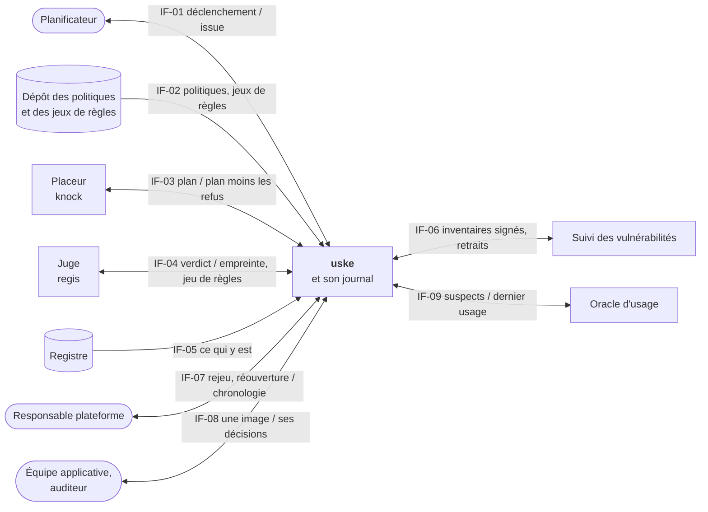
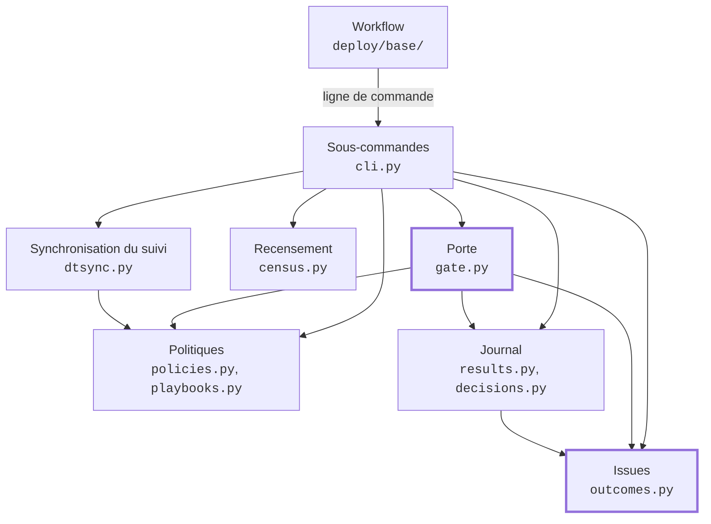
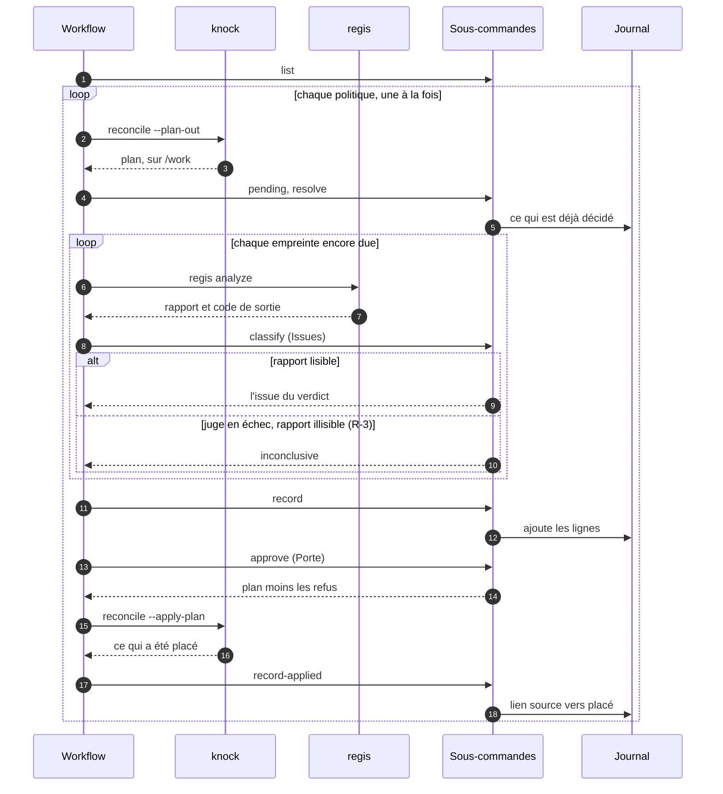
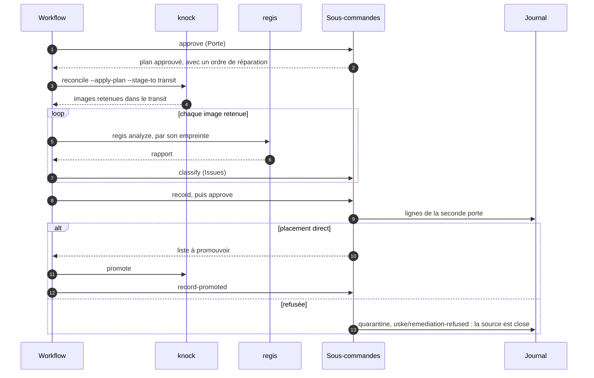
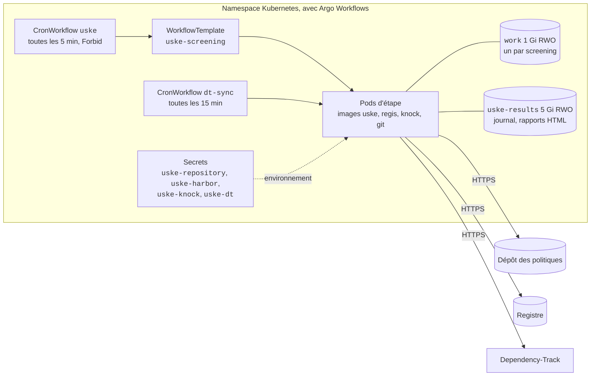

**About arc42**

arc42, the template for documentation of software and system
architecture.

Template Version 9.0-EN. (based upon AsciiDoc version), July 2025

Created, maintained and © by Dr. Peter Hruschka, Dr. Gernot Starke and
contributors. See <https://arc42.org>.

# Introduction and Goals

> État de ce document au 2026-10-17 : les douze sections sont rédigées, au niveau **LEAN** —
> des tables plutôt que des diagrammes, et rien de ce que le code ne fait pas encore. Une section
> se reprend quand un change déplace ce qu'elle décrit.

## Requirements Overview

`uske` joue ensemble un outil qui **juge** une image de conteneur et un outil qui la **place**
dans un registre. Sur planification, pour chaque politique active, il conduit un *screening* et
consigne chaque décision. Il ne juge rien et ne place rien : il appelle, il attend, il écrit.

### Essential Features

- Lister les politiques actives, tenues dans un dépôt à part, extrait à chaque screening.
- Faire écrire au placeur son plan : chaque import, mise à jour ou reconstruction qu'il s'apprête
  à faire, avec l'empreinte de la source.
- Faire juger chaque empreinte encore due d'une décision, avec le jeu de règles que le régime de
  la politique appelle.
- Classer chaque verdict en l'une de quatre issues : placement direct, transformation requise,
  quarantaine, non concluant.
- Rendre au placeur le plan, moins les opérations refusées ; il n'applique que cela. Une source
  refusée sur des règles que son régime déclare réparables y reste, avec un ordre de réparation.
- Faire retenir dans un transit ce que le placeur construit, le faire juger par sa propre
  empreinte, et ne lui rendre pour promotion que ce qui ressort en placement direct.
- Ajouter une ligne par décision à un fichier de résultats. Les lignes s'ajoutent, ne se
  réécrivent jamais.
- Recenser le registre : ce qui y est, moins ce qui a été admis, donne le contournement.
- Envoyer au suivi des vulnérabilités les inventaires signés par le placeur, et en retirer ce
  qui a quitté le registre.

### Business Context

Aujourd'hui, les images entrent dans un registre par des scripts et des chaînes d'intégration
maison, écrits équipe par équipe : jugement et placement y sont mêlés, rien n'est planifié de
façon uniforme, et rien n'est contestable après coup. **Le mal est d'abord l'absence
d'automatisation ; la contestabilité vient ensuite.** `uske` sert la personne qui tient le
registre — les images entrent seules, selon des règles déclarées —, puis celles qui subissent
ou vérifient une décision : l'équipe dont l'image est refusée, l'auditeur qui doit prouver ce
qui a été admis.

**Hors périmètre** : devenir une colle générique pour d'autres juges ou d'autres placeurs ;
toute interface graphique.

### References

- [`openspec/discovery.md`](../../openspec/discovery.md) — personas, parcours annoté contre le
  code, priorités, stories. Ce document en reprend le périmètre et les objectifs, sans les
  recopier au-delà.
- [`README.md`](../../README.md) — ce que fait un screening, pas à pas.

## Quality Goals

> Quatre objectifs, **ordonnés** : en cas de conflit, le rang le plus haut l'emporte. Chacun dit
> ce à quoi il fait renoncer — un objectif qui ne coûte rien n'en est pas un. Toute décision
> d'architecture les sert, dans cet ordre. Source et ordre : `openspec/discovery.md`, réponses
> reçues le 2026-09-20.

| Rang | Objectif | Scénario vérifiable | Renonce à |
|:----:|----------|---------------------|-----------|
| 1 | **Sûreté** `#safe` — dans le doute, ne rien placer | Un verdict absent, illisible ou non concluant vaut refus : sur un screening où le juge ne répond pas, **zéro** opération est rendue au placeur pour les empreintes concernées. | La fraîcheur : une image saine peut attendre un screening de plus. |
| 2 | **Contestabilité** `#secure` (non-répudiation) — toute décision est consignée, jamais réécrite, retrouvable | Un refus vieux de trois semaines se retrouve et s'explique **en une minute** — date, état, jeu de règles, raison ; et l'historique du fichier de résultats ne montre **aucune** ligne modifiée ou supprimée. | La compacité du journal, et toute correction en place d'une ligne fausse : on ajoute, on ne rature pas. |
| 3 | **Opérabilité** `#operable` — un screening qui échoue se diagnostique et se rejoue sans dégât | **Une seule** personne rejoue un screening interrompu à n'importe quelle étape ; le rejeu ne place rien deux fois et ne perd aucune ligne de résultat. | La vitesse d'exécution : les étapes restent séparées, lisibles et rejouables plutôt que fondues. |
| 4 | **Minceur** `#flexible` — `uske` ne juge ni ne place, et ne grossit pas | `uske` ne contient **aucune** règle de jugement et **aucun** geste de placement : retirer le juge ou le placeur le laisse sans rien à décider. | La commodité d'un outil qui ferait tout. Dernière du rang : quand la sûreté exige que `uske` vérifie lui-même quelque chose, il grossit. |

Les scénarios mesurables sont en *Quality Requirements* (`QS-01` à `QS-07`).

## Stakeholders

| Role/Name | Contact | Expectations |
|-----------|---------|--------------|
| **Responsable plateforme** — tient le registre ; persona principale | persona ; à défaut de personne réelle, répond : le mainteneur | Qu'un screening tourne sur planification sans elle, que rien de douteux n'entre, et qu'elle comprenne assez l'enchaînement des étapes pour rejouer seule un screening échoué. |
| **Équipe applicative** — attend une image pour livrer | persona ; répond : le mainteneur | Savoir pourquoi son image n'est pas arrivée : la raison du refus et la règle appliquée, sans archéologie. |
| **Auditeur sécurité / conformité** | persona ; répond : le mainteneur | Un journal qui fait foi : pour une image et une date, la décision, le jeu de règles et la raison ; et la preuve qu'aucune ligne n'a été réécrite. |
| **Auteur et mainteneur** | dépôt `trivoallan/uske` | Savoir où poser du code et ce qui a le droit de dépendre de quoi ; retrouver pourquoi une décision a été prise. Premier utilisateur réel, sur un seul registre. |
| **Agents qui écrivent les changes** | contexte d'agent du dépôt | Lire les objectifs et les décisions en un lieu, sans les déduire du code. |

**Ces cinq rôles sont les parties prenantes du système, pas le lectorat de ce document.** Trois
d'entre eux sont des personas : aucune personne réelle ne les tient aujourd'hui, et c'est le
mainteneur qui répond à leur place. Le lectorat de la documentation, lui, est fixé par
[`SDR-0019`](../adr/SDR-0019-documentation-publique.md) à `public` : le document se lit hors de
l'organisation, et les termes du métier — `screening`, `régime`, `contournement`, `juge`,
`placeur` — sont définis en *Glossary*.

**Validation des objectifs qualité** : le mainteneur, qui en a fixé l'ordre le 2026-09-20.

# Architecture Constraints

> Ce qu'un développeur ne peut pas défaire seul. Le test appliqué à chaque ligne : *en sortir
> demande-t-il une décision d'organisation ?* Si un change suffit à s'en affranchir, ce n'est pas
> une contrainte, c'est une décision — et sa place est en *Architecture Decisions*.

| Contrainte | Nature | Ce qu'elle impose | Comment en sortir |
|------------|--------|-------------------|-------------------|
| **La méthode `surdesrails`** — posée en dépendance de développement du dépôt | organisationnelle | Le format des décisions (MADR), leur numérotation `SDR-nnnn`, le schéma qui refuse une décision non statuée, et le jeu de questions auxquelles tout dépôt qui l'adopte doit répondre. | Retirer la dépendance et répondre à chaque question à la main. Ce n'est pas un change : c'est renoncer à la méthode. |
| **Un ADR `accepted` est gelé** — [`SDR-0001`](../adr/SDR-0001-record-architecture-decisions.md) | organisationnelle | Le corps d'une décision statuée ne se corrige pas. Tout ce qui en découle — le français par défaut, le langage, le modèle de branches, le seuil de couverture — n'est pas rouvrable par un change. | Un nouvel ADR qui nomme l'ancien dans son `supersedes:`. L'ancien reste au répertoire. |
| **`regis` et `knock` sont des dépôts tiers** | technique | `uske` ne les connaît que par leur ligne de commande et leur code de sortie ; il ne partage avec eux ni code ni modèle de données. Leurs cycles de version ne sont pas les siens. | Rien ici : c'est la séparation que sert l'objectif de **Minceur**, et l'abandonner viderait `uske` de sa raison d'être. |

**La méthode est une contrainte, pas une décision, et c'est ce qui explique la forme de
*Architecture Decisions*.** Les onze ADR hérités de la méthode n'ont pas été choisis : ils ont
été posés, avec leurs numéros et leurs questions. Ce que ce dépôt décide, c'est la **réponse** à
chacun — pas l'existence de la question. Un lecteur qui prendrait le journal des décisions pour une
délibération libre se tromperait sur ce qui a réellement été arbitré ici.

**La voie de recours est nommée, et elle est asymétrique.** Une question qui ne se pose pas dans
ce dépôt reçoit le verdict `rejected` avec son motif, ce qui la fait taire entièrement ; une
règle particulière se déroge par un ADR local qui écrit son motif. Mais certaines clés n'admettent
qu'une valeur, et celles-là ne se dérogent pas — elles se rejettent en bloc.

# Context and Scope

> Niveau LEAN : un diagramme et une table par contexte. La frontière tient en une phrase —
> `uske` et son journal sont dedans, tout ce qu'il appelle est dehors. Les diagrammes de ce
> document sont en Mermaid, que GitHub affiche sans outil : c'est ce que
> [`SDR-0019`](../adr/SDR-0019-documentation-publique.md) (`tool: aucun`) permet.
> Les `IF-nn` sont ceux de ce document : un `IF-nn` cité dans le code vient du dossier de
> référence, et ne désigne pas la même interface.

## Business Context

`uske` est **au milieu et ne tient rien** : chaque partenaire ci-dessous juge, place, recense
ou suit, et `uske` ne fait que leur passer ce que l'autre a produit. La seule chose qu'il
possède est le **journal des résultats** — c'est pourquoi il est dedans, et non un partenaire.

| ID | Partenaire | Ce qui entre dans `uske` | Ce qui sort de `uske` |
|----|------------|--------------------------|-----------------------|
| IF-01 | **Planificateur** | Le déclenchement d'un screening | Une issue : réussi (refus et non-concluants compris) ou échec technique, à rejouer |
| IF-02 | **Dépôt des politiques et des jeux de règles** | Les politiques actives et leur régime ; les jeux de règles | rien — lu, jamais écrit |
| IF-03 | **Placeur** (`knock`) | Son plan ; ce qu'il a retenu en transit ; ce qu'il a placé | Le plan moins les opérations refusées ; la liste à promouvoir |
| IF-04 | **Juge** (`regis`) | Un verdict et son rapport, par empreinte | Une empreinte et le jeu de règles que le régime appelle |
| IF-05 | **Registre** | Ce qui y est | rien — lu, jamais écrit ; `uske` n'y place ni n'en retire rien |
| IF-06 | **Suivi des vulnérabilités** | Ce qu'il suit déjà | Les inventaires signés par le placeur ; le retrait de ce qui a quitté le registre |
| IF-07 | **Responsable plateforme** | Le rejeu d'un screening ; une ligne de réouverture ajoutée au journal | La chronologie des décisions d'une image |
| IF-08 | **Équipe applicative, auditeur** | Une image, ou un état et une période | Les décisions, le jeu de règles et la raison de chacune — en lecture seule |
| IF-09 | **Oracle d'usage** — la commande que la rétention de la maison lance déjà | La dernière fois qu'une image a servi, ou rien | Les seules images suspectes de contournement, une par une |

**Hors frontière, même si on les croit dedans :**

- **Le transit.** `uske` le nomme au placeur, mais n'y lit ni n'y écrit : le placeur y retient,
  le juge y lit. Le fermer aux consommateurs est le travail du registre.
- **La signature et l'attestation** : c'est le placeur qui signe ; `uske` vérifie une signature
  avant d'envoyer un inventaire (IF-06), il n'en produit aucune.
- **Les règles de jugement** : elles sont dans les jeux de règles (IF-02) et chez le juge. La
  seule table que `uske` tient est celle qui associe un régime à un jeu de règles.

Le reste du hors-périmètre — colle générique, interface graphique — est fixé en *Business
Context* de la première section.

## Technical Context

Chaque interface métier a un seul canal. **`uske` n'appelle ni `regis` ni `knock`** : chacun
tourne dans sa propre image, à sa propre étape du workflow, et les étapes se passent des fichiers
sur le volume `/work` du screening (*Architecture Constraints*). `uske` ne parle HTTP qu'aux deux
API qu'il connaît par leur nom.

| ID | Canal | Format | Authentification |
|----|-------|--------|------------------|
| IF-01 | Argo Workflows : un `CronWorkflow` enchaîne les sous-commandes de `uske` ([`deploy/base`](../../deploy/base)) | Arguments en ligne de commande, JSON sur la sortie standard ; code de sortie 0 (issue métier) ou 1 (échec technique, qu'Argo rejoue) | Le compte de service du `CronWorkflow` |
| IF-02 | `git` : le dépôt est extrait à chaque screening, à l'étape `checkout` | YAML (politiques, jeux de règles) | Celle du dépôt ; nommé par le paramètre `repository` de l'overlay |
| IF-03 | Étapes Argo à part, image `knock` : `reconcile --plan-out`, `--apply-plan`, `--stage-to`, `promote` ; fichiers sur `/work` | JSON (plan, audit) | Les identifiants de registre de `knock` (`KNOCK_REGISTRIES`) |
| IF-04 | Étape Argo à part, image `regis` : `regis analyze` ; son code de sortie est passé à `uske classify` (`--regis-exit`) | JSON (rapport), sur `/work` | Les identifiants de registre de `regis`, sur l'hôte de la destination |
| IF-05 | HTTP, API Harbor `/api/v2.0` (`uske census`) | JSON | Basique : `HARBOR_URL`, `HARBOR_USER`, `HARBOR_PASSWORD` |
| IF-06 | HTTP, API Dependency-Track `/api` (`uske dt-plan`, `dt-publish`, `dt-retire`) | JSON ; inventaires CycloneDX | Clé d'API : `DT_URL`, `DT_API_KEY` |
| IF-07 | `kubectl` : un pod jetable qui monte le volume `uske-results` (README, *Why was an image not placed?*) | Une ligne JSON ajoutée au fichier de résultats ; Markdown en sortie de `uske decisions` | Les droits Kubernetes de la personne sur le namespace |
| IF-08 | Le même pod, volume monté en lecture seule | Markdown (chronologie Mermaid et tableau) | Idem |
| IF-09 | Processus enfant de `uske census` : la commande nommée par `KNOCK_USAGE_ORACLE_CMD` | JSON sur l'entrée standard ; `{"last_seen": …}` en sortie, code 0 pour répondre | Celle de la commande |

# Solution Strategy

> Niveau LEAN : ce qui a été choisi et le motif en une ligne. Le pourquoi complet est dans
> l'ADR nommé ; une ligne sans ADR est une décision qui n'en a pas encore.

**Un enchaîneur de commandes qui échoue fermé.** Chaque étape d'un screening est une
sous-commande courte de `uske` — elle lit des fichiers, appelle un outil, écrit du JSON — et
c'est le planificateur qui les enchaîne. `uske` ne garde aucun état en mémoire d'une étape à
l'autre : ce qui passe d'une étape à la suivante est un fichier, et ce qui reste après le
screening est une ligne du journal. Tout ce qui n'est pas un verdict lisible de placement direct
se lit comme un refus.

## Choix techniques

| Sujet | Choix | Motif | Où |
|-------|-------|-------|----|
| Langage | Python ≥ 3.12 | L'un des trois que la méthode recommande ; celui de `regis` et `knock`, donc un seul outillage pour les trois dépôts | [`SDR-0004`](../adr/SDR-0004-languages.md) |
| Enchaînement | Argo Workflows : un `CronWorkflow`, une sous-commande par étape | Le rejeu, les reprises et la trace de chaque étape viennent de l'outil, pas de `uske` | **aucun ADR** — `DEBT-07` |
| Intégration | `regis` et `knock` à leurs propres étapes du workflow, par fichiers ; Harbor et Dependency-Track par HTTP, en bibliothèque standard | Ne partager ni code ni image avec les outils enchaînés ; une seule dépendance d'exécution (`pyyaml`) | *Architecture Constraints* |
| Persistance | Un fichier JSON Lines par politique, en ajout seul, sur un volume | Un fichier se lit, se copie et se conteste sans serveur ; l'ajout seul se vérifie dans son historique | [`SDR-0016`](../adr/SDR-0016-journal-et-transit.md), [`SDR-0018`](../adr/SDR-0018-journal-run.md) ; le support lui-même : **aucun ADR** — `DEBT-08` |
| Structure du code | Hexagonale : le domaine sans entrée-sortie | Un agent modifie et teste une règle sans environnement qui tourne | [`SDR-0003`](../adr/SDR-0003-architecture.md) — non tenu, `DEBT-01` |
| Validation | `pydantic` aux frontières, JSON Schema pour les fichiers | Un champ absent devient une erreur nommée, pas un défaut silencieux | [`SDR-0005`](../adr/SDR-0005-validation.md) — non tenu, `DEBT-02` |

## Approche par objectif qualité

| Objectif | Mécanisme principal | Où |
|----------|---------------------|----|
| 1. **Sûreté** `#safe` | **Échec fermé** : un rapport absent ou illisible devient `inconclusive` (`outcomes.py`, D-23 du dossier de référence). N'est rendu au placeur que le placement direct, et la transformation requise quand `uske` ordonne une réparation (règles réparables du régime, `playbooks.REPAIRABLE`). Le placeur n'applique une opération que si son empreinte source n'a pas changé depuis le plan (`gate.py`, D-30). Ce qu'il reconstruit passe une **seconde porte**, depuis un transit obligatoire. | `SDR-0016` ; *Runtime View* R-2, R-3 ; QS-01, QS-02 |
| 2. **Contestabilité** `#secure` | **Journal en ajout seul, qui n'avance que vers l'avant** : une ligne plus ancienne que la dernière du même digest n'est pas écrite. Chaque ligne porte son état, son jeu de règles, sa raison et son screening (`run`) ; `uske decisions` les rend lisibles. | `SDR-0016`, `SDR-0018` |
| 3. **Opérabilité** `#operable` | **Des étapes séparées et rejouables** : JSON sur la sortie, code de sortie 0 pour toute issue métier et 1 pour un échec technique, qu'Argo rejoue. Le journal à sens unique rend un rejeu sans effet sur ce qui est déjà écrit ; une image retenue sans verdict est retentée trois fois au plus. | *Runtime View* R-4 ; *Deployment View* ; QS-05, QS-06 |
| 4. **Minceur** `#flexible` | **Rien à juger, rien à placer** : la seule table métier est celle qui associe un régime à un jeu de règles (`playbooks.py`). Les autres outils ne sont connus que par leur ligne de commande ou leur API. | *Architecture Constraints* |

**La Sûreté coûte déjà de la Minceur, et c'est voulu** : `gate.py` compte lui-même les
tentatives et clôt une source dont la reconstruction a été refusée, ce qu'un `uske` réduit à un
simple enchaînement ne ferait pas. Le rang des objectifs le permet ; la ligne 4 de *Quality Goals* l'avait annoncé.

# Building Block View

> Niveau LEAN : le niveau 1 seul, en diagramme et en table. Un bloc est un groupe de modules de `uske/`, ou le
> workflow de `deploy/base` ; aucun ne descend au fichier près plus qu'il ne le faut — le paquet
> compte dix modules à plat, et quatre blocs n'en ont qu'un.

## Whitebox Overall System

**Deux blocs au centre, sans entrée-sortie, et des adaptateurs autour.** *Issues* et *Porte*
décident ; tout le reste lit, écrit ou parle à un partenaire. C'est la forme que vise
[`SDR-0003`](../adr/SDR-0003-architecture.md), à moitié atteinte : les deux sont déjà purs, mais
rien dans l'arborescence ne sépare le domaine des adaptateurs (`DEBT-01`).

Trait épais : sans entrée-sortie. Chaque flèche est une dépendance d'import, sauf la première.

| Bloc | Responsabilité | Source | Dépend de | Interfaces | Entrées-sorties |
|------|----------------|--------|-----------|------------|-----------------|
| **Workflow** | Enchaîner les étapes d'un screening : extraire le dépôt, lancer `knock`, `regis` et les sous-commandes de `uske`, chacun dans son image, et leur passer des fichiers sur `/work` | `deploy/base/` | toutes les sous-commandes, par leur ligne de commande | IF-01, IF-02, IF-03, IF-04 | oui — c'est sa raison d'être |
| **Sous-commandes** | Une sous-commande par étape : lire les fichiers et l'environnement, appeler le bloc qui décide, écrire du JSON, et traduire l'issue en code de sortie (0 métier, 1 technique) | `uske/cli.py` | tous les blocs ci-dessous | IF-01, IF-07, IF-08 | oui |
| **Issues** | Ramener un rapport du juge à l'une des quatre issues, en échouant fermé | `uske/outcomes.py` | — | IF-04, par le rapport que lui passent les sous-commandes | **non** |
| **Porte** | Rendre le plan moins les refus ; compter les tentatives d'une reconstruction et clore une source refusée | `uske/gate.py` | Issues, Politiques, Journal (les derniers états, déjà lus) | IF-03, par le plan que lui passent les sous-commandes | **non** |
| **Politiques** | Lire les politiques ; associer un régime à un jeu de règles — la seule table métier de `uske` | `uske/policies.py`, `uske/playbooks.py` | — | IF-02 | lecture seule |
| **Journal** | Écrire une ligne par décision, en ajout seul et vers l'avant ; relire le journal pour une personne | `uske/results.py`, `uske/decisions.py` | Issues | IF-07, IF-08 | oui |
| **Recensement** | Compter le contournement : ce qui est au registre, moins ce qui est passé par la porte, puis demander l'usage des seuls suspects | `uske/census.py` | — | IF-05, IF-09 | oui |
| **Synchronisation du suivi** | Envoyer au suivi des vulnérabilités les inventaires signés, après en avoir vérifié la signature ; retirer ce qui a quitté le registre | `uske/dtsync.py` | Politiques | IF-06 | oui |

**Aucune dépendance circulaire.** *Issues*, *Politiques* et *Recensement* n'importent rien de
`uske` ; le *Journal* ne dépend que d'*Issues*, et la *Porte* de trois blocs qui ne dépendent pas
d'elle. *Issues* est un bloc à part pour cette raison : rangé avec la *Porte*,
il faisait un cycle — la *Porte* lit le *Journal*, et le *Journal* écrit des issues.

**Le Journal appartient à `uske`, et c'est le seul bloc à garder un état** d'un screening à
l'autre. Tout le reste se recalcule : *Issues* et la *Porte* d'un rapport et d'un plan, le Recensement et la
Synchronisation du registre lui-même.

**Ce que la table dit de `DEBT-01`.** La colonne *Entrées-sorties* trace la frontière que
l'hexagone demande : seules *Issues*, la *Porte* et la table des régimes en sont déjà du bon côté. Le
Journal et les Politiques mêlent une règle (n'écrire que vers l'avant, lire un régime) et la
lecture d'un fichier ; le Recensement et la Synchronisation mêlent une règle (soustraire, planifier)
et un appel HTTP. Rapprocher le code, c'est séparer ces deux moitiés dans chacun des quatre.

# Runtime View

> Niveau LEAN : cinq scénarios en prose numérotée ; les deux portes, R-1 et R-2, ont aussi leur
> diagramme de séquence. Les noms en italique sont
> les blocs de *Building Block View* ; les `IF-nn`, les interfaces de *Context and Scope*. Chaque
> étape nommée en `code` est une étape de [`deploy/base/workflowtemplate.yaml`](../../deploy/base/workflowtemplate.yaml).

## R-1 — Un screening, une copie placée

Le cas nominal : une image saine, copiée telle quelle. Le diagramme montre aussi la branche de
R-3.

1. Le planificateur lance un screening (IF-01) ; le *Workflow* extrait le dépôt des politiques
   (`checkout`, IF-02), puis `list` en tire les politiques actives.
2. Pour chaque politique, une à la fois (un verrou par politique) : `prepare`, puis le placeur
   écrit son plan sans rien placer (`plan`, IF-03).
3. `pending` retire du plan ce que le *Journal* a déjà décidé ; `resolve` demande aux
   *Politiques* le jeu de règles que le régime appelle.
4. Pour chaque empreinte encore due, le juge l'analyse (`regis`, IF-04) ; *Issues* ramène son
   rapport à une issue, et `classify` en écrit la ligne sur `/work`.
5. `record` ajoute ces lignes au *Journal* ; `approve` demande à la *Porte* le plan moins les
   refus ; le placeur n'applique que cela (`place`, IF-03).
6. `record-applied` consigne ce qui a été placé. Le screening se termine en succès.

## R-2 — Une source à réparer, et la seconde porte

1. Comme R-1 jusqu'à l'étape 4 ; le verdict est *transformation requise*, et chaque règle
   critique en échec figure parmi les règles réparables du régime (`playbooks.REPAIRABLE`).
2. La *Porte* rend l'opération avec un ordre de réparation, seulement si le workflow nomme un
   transit ; sans transit, la source est consignée `inconclusive` (`uske/no-transit`) et rejugée
   au screening suivant. Les copies et les reconstructions par simple transformation, elles, sont
   placées directement, sans seconde porte.
3. Le placeur répare et retient l'image dans le transit (`place-staged`), sans la placer.
4. `second-gate` : le juge analyse l'image retenue **par sa propre empreinte**. Seule une issue
   *placement direct* est rendue au placeur pour promotion.
5. Une réparation refusée clôt sa source : une ligne `quarantine`, raison
   `uske/remediation-refused` (les lignes plus anciennes disent `uske/rebuild-refused`), et la
   source n'est plus réparée. Un ordre sur un import qui ne déclare aucun `remediate:` la clôt
   aussi (`uske/remediation-undeclared`). Une image retenue sans verdict
   est retentée, trois fois au plus.

## R-3 — Le juge ne répond pas

Le scénario qui démontre l'objectif de **Sûreté**.

1. `regis` échoue, ou son rapport est vide, illisible, ou sans tier connu. L'étape échoue sans
   arrêter le screening (`continueOn: failed`).
2. `classify` reçoit son code de sortie (`--regis-exit`) ; *Issues* rend `inconclusive`.
3. La *Porte* ne rend **aucune** opération pour cette empreinte : rien n'est placé.
4. Le screening se termine en succès — un non-concluant est une issue métier, code 0 — et le
   suivant juge à nouveau l'empreinte, puisque le *Journal* ne la tient pas pour décidée.

## R-4 — Une étape tombe, et on rejoue

Le scénario qui démontre l'objectif d'**Opérabilité**.

1. Une étape échoue techniquement (code 1 : politique illisible, registre injoignable). Argo
   la relance deux fois, à 10 puis 20 secondes ; c'est l'étape seule qui est rejouée, jamais
   la politique entière.
2. Si elle échoue encore, le screening échoue. La responsable plateforme le relance tel quel.
3. Le rejeu ne place rien deux fois : `pending` ne garde que ce qui est encore dû, et `record`
   n'écrit pas une ligne plus ancienne que la dernière du même digest — une source close reste
   close.
4. Si c'est l'application du placeur qui échoue, ce qui a été placé est consigné d'abord
   (`continueOn`), puis `place-failed` fait échouer le screening : l'échec reste visible, et rien
   de ce qui a été placé n'est perdu. Une opération approuvée mais non placée est réapprouvée au
   screening suivant, sans rejuger.

## R-5 — Retrouver pourquoi une image n'est pas arrivée

Le scénario qui démontre l'objectif de **Contestabilité**.

1. Une équipe ou un auditeur demande la décision sur une image (IF-08).
2. La responsable plateforme lance `uske decisions` dans un pod jetable qui monte le volume du
   journal en lecture seule (README, *Why was an image not placed?*).
3. Le *Journal* relit toutes les lignes de l'image, dans l'ordre du fichier, et rend une
   chronologie et un tableau : date, état, jeu de règles, raison, screening, rapport.
4. Une référence courte reçoit les références complètes en suggestion ; le volume est
   `ReadWriteOnce` : pendant un screening sur un autre nœud, la lecture attend.

# Deployment View

> Niveau LEAN. **`uske` n'est déployé nulle part aujourd'hui** (README, *Status*) : la seule
> infrastructure qui tourne est le banc local. Cette section décrit donc ce que tout environnement
> reçoit — [`deploy/base`](../../deploy/base) —, puis ce que le banc y ajoute. La production
> s'écrira avec son premier overlay.

## Infrastructure Level 1

Un namespace Kubernetes, avec Argo Workflows. Rien d'autre ne tourne en permanence : chaque
screening est une suite de pods qui meurent avec lui.

| Élément | Ce qu'il porte | Réglage qui compte |
|---------|----------------|--------------------|
| `CronWorkflow` `uske` | Un screening toutes les 5 minutes | `concurrencyPolicy: Forbid` : jamais deux screenings à la fois |
| `WorkflowTemplate` `uske-screening` | Les étapes de R-1 à R-4 | `parallelism: 1` ; un verrou par politique ; deux relances par étape conteneur |
| `CronWorkflow` de `dt-sync` | La synchronisation du suivi (IF-06) | Toutes les 15 minutes |
| Volume `work`, 1 Gi, `ReadWriteOnce` | Les fichiers passés d'une étape à l'autre | Créé et détruit avec chaque screening |
| Volume `uske-results`, 5 Gi, `ReadWriteOnce` | Le journal, un fichier par politique, et un rapport HTML par décision | Survit aux screenings ; seul `record` y écrit les lignes |
| Compte de service `uske` | Les pods du screening | Un seul droit : rapporter les sorties d'étape à Argo |
| Secrets | `uske-repository` (jeton du dépôt), `uske-harbor` (identifiants du registre), `uske-knock` (identifiants et clé de signature du placeur), `uske-dt` (Dependency-Track) | Lus par l'environnement des seuls conteneurs qui en ont besoin ; aucun n'est un paramètre du workflow |

**Correspondance des blocs.** Le *Workflow* est le `WorkflowTemplate` et ses deux
`CronWorkflow`. Les *Sous-commandes*, *Issues*, la *Porte*, les *Politiques*, le *Journal* et la
*Synchronisation du suivi* tournent dans l'image `uske`, un pod par étape ; le *Journal* écrit sur
`uske-results`. Le *Recensement* est dans la même image mais **n'est planifié par aucun
workflow** : il se lance à la main. `regis` et `knock` tournent dans leurs propres images,
épinglées par empreinte dans l'overlay.

**TLS.** `uske` n'en termine aucun : il est client de chaque partenaire. Harbor et
Dependency-Track sont joints par les URL que l'overlay donne ; le chiffrement est leur
affaire. Le dépôt est cloné en HTTPS.

**Ce qui sert l'Opérabilité ici** : les relances d'étape, l'interdiction de deux screenings
simultanés, et un volume de travail neuf à chaque screening — un rejeu ne trouve jamais l'état
d'un autre.

## Infrastructure Level 2

### Banc local (`deploy/kind`)

`deploy/kind/up.sh` monte un cluster kind, Argo Workflows, et Zot à la place de Harbor (TLS,
autorité de certification auto-signée, que chaque outil reçoit par `SSL_CERT_FILE`). Le
`CronWorkflow` y est suspendu : les screenings se lancent à la main. `regis` 0.41.0 et `knock`
0.16.0 y sont épinglés par empreinte. `up.sh repair` ajoute `buildkitd` et deux sources à
réparer ; `buildkitd` y écoute **en clair** sur le réseau du cluster, ce qui ne vaut que pour un
cluster jetable (RISK-06).

# Cross-cutting Concepts

> Niveau LEAN : seuls les concepts qui touchent au moins deux blocs.

## Échec fermé

Tout ce qui n'est pas une réponse lisible vaut refus. *Issues* rend `inconclusive` pour un
rapport absent, vide, illisible ou sans tier connu ; la *Porte* ne rend rien pour une empreinte
non concluante ; un fichier d'application absent veut dire que rien n'a été appliqué ; une
politique au régime inconnu n'est jamais envoyée au juge. Le *Recensement* fait l'inverse, et le
dit : une image dont l'usage reste sans réponse est comptée à part, pour ne pas faire baisser en
silence le chiffre qu'il publie.

## Un journal qui n'avance que vers l'avant

Le *Journal* ajoute, ne réécrit jamais, et refuse une ligne plus ancienne que la dernière du
même digest. La *Porte* et `pending` lisent les derniers états de ce journal pour décider de ce
qui est encore dû. C'est ce qui rend un rejeu sûr (R-4), et une décision contestable (R-5).
Corriger une ligne fausse, c'est en ajouter une, datée de maintenant — la réouverture d'une
source en est le seul usage écrit.

## Issue métier, échec technique

Toutes les *Sous-commandes* suivent la même règle : une issue métier — refus, quarantaine,
non-concluant — sort en code 0 ; seul un échec technique sort en code 1, et c'est lui qu'Argo
rejoue. Une issue métier n'est donc jamais rejouée par erreur, et un échec technique n'est jamais
pris pour un refus.

## Des fichiers entre les étapes

Aucun bloc ne garde d'état en mémoire d'une étape à l'autre. Le *Workflow* passe des fichiers
sur `/work`, dans des formats que les autres outils écrivent (le plan et l'audit de `knock`, le
rapport de `regis`) ou que `uske` écrit en JSON. Chaque étape se relit, se rejoue et se teste
avec ses seuls fichiers d'entrée.

## Ce qui n'est pas dans le code

Les politiques, leurs propriétaires et leurs régimes sont dans le dépôt des politiques ; les
adresses et les secrets, dans l'environnement. La seule connaissance métier que `uske` porte est
la table d'un régime vers un jeu de règles (`playbooks.py`), lue par les *Politiques* et par
tout ce qui en dépend.

## Sécurité

- **Les secrets** arrivent par l'environnement, depuis des `Secret` Kubernetes, et ne sont
  jamais des paramètres du workflow : ils ne s'affichent pas dans l'interface d'Argo.
- **Le moindre droit** : le compte de service ne peut que rapporter les sorties d'étape. Le
  journal se lit par un volume monté en lecture seule.
- **Rien n'est cru sur parole** : la *Synchronisation du suivi* vérifie l'attestation CycloneDX
  du placeur, avec sa clé publique, avant d'envoyer un inventaire.
- **Ce que `uske` ne protège pas** : le transit, que le registre doit fermer aux consommateurs
  (RISK-04), et le journal contre une écriture directe sur son volume (RISK-01).

# Architecture Decisions

## Overview

Les décisions d'architecture de ce dépôt vivent dans [`docs/adr/`](../adr/), une par fichier, au
format MADR. Cette section est leur **journal** : elle y renvoie, et ne recopie ni leur contexte,
ni leurs options, ni leurs valeurs — chaque ADR dit que ses valeurs s'écrivent chez lui « et
nulle part ailleurs », et c'est ce qui les empêche d'être contredites ici.

Quinze ADR à ce jour, tous statués, dont trois dépassés — deux par `SDR-0017`, un par
`SDR-0019` ; douze sont donc en vigueur. Onze sont hérités de la méthode — voir *Architecture
Constraints* : dix questions qu'elle pose à tout dépôt qui l'adopte, et la règle qui dit comment
on y répond. Quatre sont propres à `uske` : `SDR-0016` à `SDR-0019`. Une nouvelle décision s'écrit
quand un choix est cher à défaire, touche plusieurs blocs, arbitre entre deux objectifs qualité
ou contraint les changes suivants.

**La numérotation est celle de la méthode, trous compris.** Elle saute de `SDR-0011` à
`SDR-0016`. **`SDR-0012` n'existe pas en amont non plus** — vérifié le 2026-09-20 dans les
ressources du paquet, où ce numéro ne sert que de nom d'ADR orphelin dans un test de l'outil.
**`SDR-0013` a été retiré le 2026-10-16, avant l'ouverture du dépôt** : il résumait des
prescriptions internes de l'employeur, et la question qu'il posait (le front) ne se pose pas
ici, puisque `uske` ne sert aucune interface. `SDR-0014` et `SDR-0015` n'ont jamais été écrits
dans ce dépôt. Un trou dans la suite ne signale donc **aucune décision perdue**, et ce dépôt ne
renumérote pas : il porterait alors des numéros que la méthode ne reconnaîtrait plus.

**Ce journal liste aussi les questions encore ouvertes.** Un ADR `proposed` est une question
posée et non tranchée : il ne contraint rien, et le dépôt ne s'y conforme ni ne s'en écarte. Il
figure quand même au journal — savoir ce qui reste à décider vaut autant que savoir ce qui l'a
été.

**Un ADR `accepted` ne se corrige pas** : son corps est gelé
([`SDR-0001`](../adr/SDR-0001-record-architecture-decisions.md)). Pour revenir sur une décision,
un nouvel ADR la nomme dans son `supersedes:` ; l'ancien reste au répertoire, qui est un journal
et non la liste de ce qui est en vigueur. À ce jour, deux en dépassent d'autres : `SDR-0017`
dépasse `SDR-0006` et `SDR-0010`, et `SDR-0019` dépasse `SDR-0008`.

## Decision Log

| ID | Décision | Statut | Date | Objectif qualité servi | Le dépôt s'y conforme ? |
|----|----------|--------|------|------------------------|-------------------------|
| [SDR-0001](../adr/SDR-0001-record-architecture-decisions.md) | Comment les décisions se consignent | accepted | 2026-08-29 | Contestabilité | oui |
| [SDR-0002](../adr/SDR-0002-localization.md) | Langue de chaque support | accepted | 2026-09-20 | Opérabilité | en partie — `DEBT-09` |
| [SDR-0003](../adr/SDR-0003-architecture.md) | Pattern d'architecture, et où vit ce document | accepted | 2026-09-20 | Sûreté, Opérabilité | **non** — `DEBT-01` |
| [SDR-0004](../adr/SDR-0004-languages.md) | Langage principal | accepted | 2026-09-20 | Opérabilité | oui |
| [SDR-0005](../adr/SDR-0005-validation.md) | Validation aux frontières et des fichiers de données | accepted | 2026-09-20 | Sûreté, contre Minceur | **non** — `DEBT-02` |
| [SDR-0006](../adr/SDR-0006-commits.md) | Portées des commits, et ce qui tient le format | accepted — dépassé par SDR-0017 | 2026-09-20 | Contestabilité | sans objet — dépassé |
| [SDR-0007](../adr/SDR-0007-tests.md) | Seuil de couverture | accepted | 2026-09-20 | Sûreté | oui — 91 % mesuré le 2026-10-16 |
| [SDR-0008](../adr/SDR-0008-documentation.md) | Outil, racine et audience de la documentation | accepted — dépassé par SDR-0019 | 2026-09-20 | Minceur | sans objet — dépassé |
| [SDR-0009](../adr/SDR-0009-branching.md) | Modèle de branches et de fusion | accepted | 2026-09-20 | Contestabilité, Opérabilité | oui |
| [SDR-0010](../adr/SDR-0010-forge-and-ci.md) | Forge, chaîne d'intégration, et ce qu'un rouge empêche | accepted — dépassé par SDR-0017 | 2026-09-20 | Opérabilité | sans objet — dépassé |
| [SDR-0011](../adr/SDR-0011-delivery.md) | Environnements servis, et ce qui fabrique une version | accepted | 2026-09-20 | Contestabilité | oui — release-please branché le 2026-10-16 |
| [SDR-0016](../adr/SDR-0016-journal-et-transit.md) | Vocabulaire du journal pour une reconstruction, et transit obligatoire | accepted | 2026-10-10 | Sûreté, Contestabilité | oui — première décision propre à `uske` |
| [SDR-0017](../adr/SDR-0017-socle-commun.md) | Socle commun : format des titres tenu par la CI, CI bloquante | accepted | 2026-10-16 | Contestabilité, Opérabilité | oui |
| [SDR-0018](../adr/SDR-0018-journal-run.md) | Une ligne du journal nomme le criblage qui l'a écrite (clé `run`) | accepted | 2026-10-16 | Contestabilité, Opérabilité | oui — `classify --run` reçoit `{{workflow.name}}` du `WorkflowTemplate` |
| [SDR-0019](../adr/SDR-0019-documentation-publique.md) | Audience de la documentation : `public` | accepted | 2026-10-17 | Contestabilité | oui — pages relues le 2026-10-17 |

## Écarts ouverts

Les écarts entre ce que les décisions disent et ce que le dépôt fait portent un identifiant
`DEBT-nn` et vivent dans *Risks and Technical Debts*. La colonne « Le dépôt s'y conforme ? » du
journal y renvoie au lieu de redire l'état : deux endroits pour le même fait se contredisent tôt
ou tard.

**Un arbitrage entre objectifs est déjà écrit** : `SDR-0005` ajoute une dépendance, contre la
Minceur, au nom de la Sûreté. Le rang des objectifs tranche — c'est à cela qu'il sert.

# Quality Requirements

> Niveau LEAN : un scénario au moins par objectif de *Quality Goals*, avec la mesure qui dit
> s'il est tenu. Les identifiants `QS-nn` sont stables : un scénario abandonné se marque
> *Retired* et garde son numéro.

## Quality Requirements Overview

| Objectif | Scénarios |
|----------|-----------|
| 1. Sûreté `#safe` | QS-01, QS-02 |
| 2. Contestabilité `#secure` | QS-03, QS-04 |
| 3. Opérabilité `#operable` | QS-05, QS-06 |
| 4. Minceur `#flexible` | QS-07 |

## Quality Scenarios

| ID | Stimulus | Environnement | Réponse attendue | Mesure | Tenu ? |
|----|----------|---------------|------------------|--------|--------|
| QS-01 | Le juge échoue, ou rend un rapport vide, illisible ou sans tier connu | dégradé | La décision est `inconclusive` ; aucune opération n'est rendue au placeur pour cette empreinte | **0** opération rendue, sur les six cas du test | oui — `test_fail_closed` |
| QS-02 | Une image réparée est refusée à la seconde porte | normal | La source est close et n'est plus réparée | **0** ordre de réparation pour cette source aux screenings suivants | oui — `test_a_refused_rebuild_closes_its_source` |
| QS-03 | Une équipe conteste un refus vieux de trois semaines | normal | Date, état, jeu de règles et raison retrouvés par `uske decisions` | **1 minute** au plus, de la question à la réponse | **non mesuré** — aucun journal réel n'a trois semaines (RISK-02) |
| QS-04 | On compare deux copies successives d'un fichier de résultats | normal | La plus ancienne est un préfixe de la plus récente | **0** ligne modifiée ou supprimée | en partie — `test_append_only_and_repeat_suppressed` couvre `uske` ; rien ne protège le volume lui-même (RISK-01) |
| QS-05 | Une première porte est rejouée après la clôture d'une source | dégradé | La source reste close | **0** ligne qui la rouvre | oui — `test_replaying_the_first_gate_does_not_reopen_a_closed_source` |
| QS-06 | Le placeur échoue en appliquant le plan approuvé | dégradé | Ce qui a été placé est consigné ; le reste est réapprouvé au screening suivant, sans rejuger | **0** ligne perdue, **0** appel au juge pour une opération déjà approuvée ; **une** personne relance | oui — `test_failed_placement_is_approved_again_without_regis` |
| QS-07 | Le juge ou le placeur est retiré du dépôt | normal | `uske` n'a plus rien à décider | **0** règle de jugement dans `uske/` ; la seule table métier est `playbooks.py` | oui, par relecture — aucun test ne le vérifie |

# Risks and Technical Debts

> Niveau LEAN. Les `RISK-nn` et `DEBT-nn` sont stables : un élément réglé se marque *Closed* et
> garde son numéro, il ne disparaît pas de la table.

## Risks

| ID | Priorité | Risque | Probabilité × impact | Ce qui le réduit |
|----|----------|--------|----------------------|------------------|
| RISK-01 | **haute** | Le journal vit sur un volume, sans historique : une écriture directe sur le volume réécrit une ligne, et rien ne le voit. L'objectif de Contestabilité promet « aucune ligne modifiée » sans moyen de le prouver hors de `uske`. | possible × fort | Rien encore. Une copie datée du journal hors du volume rendrait QS-04 vérifiable ; le support est à décider (`DEBT-08`) |
| RISK-04 | **haute** | Un transit que les consommateurs peuvent tirer expose une image reconstruite **avant** son jugement. `knock` refuse seulement un transit qui est aussi une destination. | possible × fort | Le registre ferme le transit aux consommateurs (README, *Rebuilds and repairs*) ; `uske` ne le vérifie pas |
| RISK-02 | moyenne | `uske` n'est déployé nulle part : QS-03 n'a jamais été mesuré, et le rythme de 5 minutes n'a pas été confronté à un vrai registre. | certain × moyen | Le premier overlay de production, puis une mesure de QS-03 sur un refus réel |
| RISK-03 | moyenne | Avec un `knock` antérieur à 0.13.0, rien n'est réparé, et rien ne dit pourquoi. | faible × moyen | L'overlay épingle `knock` par empreinte ; le banc tient 0.16.0 |
| RISK-05 | basse | Le volume du journal est `ReadWriteOnce` : un pod de lecture attend la fin d'un screening qui tourne sur un autre nœud. | probable × faible | Attendre ; un stockage `ReadWriteMany` lèverait l'attente et le `parallelism: 1` |
| RISK-06 | basse | Sur le banc, `buildkitd` écoute en clair sur le réseau du cluster. | certain × faible, sur le banc seulement | Hors du banc : mTLS ou une `NetworkPolicy` |

## Technical Debts

Cinq dettes viennent d'une décision qui disait où le dépôt allait, pas où il était ; chacune écrit
son écart sous son titre *Consequences*. `SDR-0017` en a refermé trois le 2026-10-16. Les autres
viennent d'une revue.

| ID | Écart | Bloc | Origine | Ce qui le referme |
|----|-------|------|---------|-------------------|
| DEBT-01 | L'arborescence du code contredit le pattern décidé ; un agent lit une structure que l'ADR dément, et suit l'ADR pour le code nouveau | *Journal*, *Politiques*, *Recensement*, *Synchronisation du suivi* | [`SDR-0003`](../adr/SDR-0003-architecture.md) | Le rapprochement du code existant, change après change |
| DEBT-02 | La validation aux frontières se fait à la main ; un champ absent reste un défaut silencieux au lieu d'une erreur nommée | *Sous-commandes*, *Politiques* | [`SDR-0005`](../adr/SDR-0005-validation.md) | Les frontières existantes portées sur l'outil décidé |
| DEBT-03 | Le format des messages de commit n'est tenu par rien ; un message hors format passe | — la chaîne | [`SDR-0006`](../adr/SDR-0006-commits.md) | *Closed* 2026-10-16 par [`SDR-0017`](../adr/SDR-0017-socle-commun.md) : le workflow `pr-title` vérifie le titre par une expression régulière ; `commitlint` n'a pas été installé. (Critère d'origine : `commitlint` installé et branché sur le titre de la demande de fusion.) |
| DEBT-04 | La couverture de tests n'est pas mesurée : le seuil décidé n'est ni tenu ni démenti | — la chaîne | [`SDR-0007`](../adr/SDR-0007-tests.md) | *Closed* 2026-10-16. Un instrument branché, et une première mesure prise |
| DEBT-05 | Rien ne fabrique une version : les livraisons ne se déduisent d'aucun commit | — la chaîne | [`SDR-0011`](../adr/SDR-0011-delivery.md) | *Closed* 2026-10-16. L'outil de release installé — il dépend de DEBT-03 |
| DEBT-06 | Le schéma des ADR n'est lancé par personne : une décision laissée vide ou non statuée passe sans que rien ne le dise | — la chaîne | revue du 2026-09-20 | Le contrôle ajouté à la cible `lint` du `Makefile`, ou dit manuel dans un ADR qui dépasse [`SDR-0017`](../adr/SDR-0017-socle-commun.md) |
| DEBT-07 | Argo Workflows enchaîne les étapes, et rien ne dit pourquoi : c'est lui qui rend un rejeu possible, et le quitter réécrirait tout `deploy/` | *Workflow* | revue du 2026-10-17, en écrivant *Solution Strategy* | Un ADR qui statue le planificateur, options écartées comprises |
| DEBT-08 | Le journal est un fichier JSON Lines par politique sur un volume, et rien ne dit pourquoi : `SDR-0016` fixe son vocabulaire, pas son support ; l'objectif de Contestabilité repose sur ce support (RISK-01) | *Journal* | revue du 2026-10-17, en écrivant *Solution Strategy* | Un ADR qui statue le support du journal, options écartées comprises |
| DEBT-09 | `README.md` est en anglais d'abord, contre la règle du français par défaut | — la documentation | [`SDR-0002`](../adr/SDR-0002-localization.md) | Le README réécrit en français, ou l'écart accepté dans un ADR |

**Deux motifs reviennent, et ce sont eux qu'il faut surveiller.** Le premier : une
vérification décidée sans être branchée — `DEBT-03`, refermé, et `DEBT-06`, ouvert ; un dépôt
qui décide des contrôles sans les brancher finit par croire ses décisions tenues. Le second, son
inverse : une décision branchée sans être décidée — `DEBT-07` et `DEBT-08`. Les deux trompent de
la même façon : le journal des décisions ne dit pas ce que le dépôt fait.

# Glossary

> L'audience est `public` ([`SDR-0019`](../adr/SDR-0019-documentation-publique.md)) : ce
> glossaire définit les termes du métier, puis les identifiants et les sigles qu'un lecteur
> rencontre dans ce document. Les noms de blocs sont définis dans la table de *Building Block
> View*.

| Terme | Définition |
|-------|------------|
| Juge | L'outil qui dit si une image peut entrer : `regis`. Il rend un verdict, il ne place rien. |
| Placeur | L'outil qui fait entrer les images dans le registre, par copie ou par reconstruction, et qui atteste ce qu'il a fait : `knock`. Il ne juge rien. |
| Politique | Un fichier du dépôt des politiques : une source à faire entrer au registre, sa destination et son régime (le label `admission-track`). Le placeur la lit pour écrire son plan. |
| Régime | Le niveau d'exigence d'une politique. Il désigne le jeu de règles avec lequel le juge l'évalue (`playbooks.py`). |
| Jeu de règles, *playbook* | Les règles qu'applique le juge, et les tiers auxquels elles mènent. |
| Empreinte, *digest* | L'identifiant d'une image par son contenu. Un verdict porte sur une empreinte, pas sur une étiquette. |
| Issue | Ce qu'un verdict décide pour une image : placement direct, transformation requise, quarantaine ou non concluant. |
| Tier | Le nom que le jeu de règles donne à son verdict ; `uske` le ramène à une issue. |
| Quarantaine | L'issue d'une image refusée : rien n'est placé. |
| Non concluant, `inconclusive` | L'issue d'une évaluation qui n'a pas abouti : rien n'est décidé, rien n'est placé, et le screening suivant rejuge. |
| Réparation, *remediation* | Une reconstruction ordonnée par `uske` pour une source refusée sur des règles que son régime déclare réparables. L'image réparée est jugée avant d'être placée. |
| Transit | Le lieu où le placeur retient une image reconstruite tant qu'elle n'a pas son propre verdict. Les consommateurs ne doivent pas pouvoir y tirer. |
| Seconde porte | Le jugement d'une image retenue dans le transit, par sa propre empreinte. |
| Contournement | Ce qui est au registre sans être passé par `uske` : le recensement le compte. |
| *screening*, *criblage* | Le même mot. Ce document et le README disent *screening* ; `SDR-0018` et les raisons écrites au journal (`outcomes.py`, [`raisons.md`](../reference/raisons.md)) disent *criblage*. |
| `D-nn` | Une décision du dossier de référence de l'espace de travail, pas de ce dépôt. Citée dans le code (`D-23`, `D-30`). |
| `IF-nn` | Une interface de *Context and Scope*. Un `IF-nn` cité dans le code vient du dossier de référence, et n'est pas le même. |
| `SDR-nnnn` | Un ADR de ce dépôt, numéroté par la méthode `surdesrails` ; les trous sont expliqués en *Architecture Decisions*. |
| `QS-nn`, `RISK-nn`, `DEBT-nn` | Un scénario de qualité, un risque, une dette de ce document. Stables. |
| ADR, MADR | *Architecture Decision Record* ; MADR en est le format, imposé par la méthode. |
| JSON Lines | Un objet JSON par ligne : le format du journal. |
| SBOM, CycloneDX | L'inventaire des composants d'une image ; CycloneDX en est le format, que le placeur signe et que le suivi des vulnérabilités reçoit. |
| `ReadWriteOnce` | Un volume Kubernetes qu'un seul nœud monte à la fois. |
