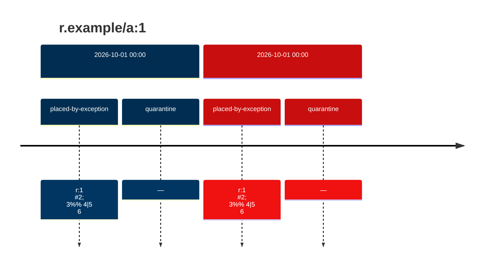

## p · r.example/a:1

`sha256:1111111111111111111111111111111111111111111111111111111111111111`

| ts | run | state | reason | ruleset | report | details |
| --- | --- | --- | --- | --- | --- | --- |
| 2026-10-01T00:00:00Z |  | placed-by-exception | r:1 #2; 3%% 4\|5 6 | none |  | arbitration: {"by": "b", "reason": "x\|y\r\nz"} |
| 2026-10-01T00:00:00Z |  | quarantine | — |  |  |  |